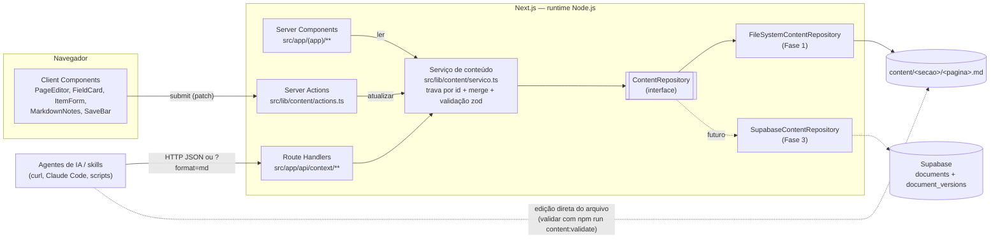

# BusinessOS — Spec técnica (contrato de implementação)

> **Status:** v1.0 · 2026-11-08 · Fase 1 (local, arquivos `.md`, sem banco, sem auth).
> **Fontes:** decisões do orquestrador (fonte única — esta spec detalha, não muda), `docs/01-briefing.md`, `docs/02-prd.md`.
> **Leitores:** agentes implementadores das Ondas 2–4. Onde houver código nesta spec, ele é **normativo**: copie nomes, tipos, chaves e mensagens exatamente.

Convenções de linguagem desta spec:

- **DEVE / NÃO DEVE** = obrigatório. **PODE** = opcional, a critério de quem implementa.
- Nomes de campos de conteúdo: `snake_case`. Valores de opções (`selecao`), status e slugs: `kebab-case`. Código TS: `camelCase` para funções/variáveis, `PascalCase` para tipos/componentes.
- Tudo voltado à pessoa usuária (UI, mensagens de erro, comentários de código) em **português do Brasil**.

---

## Sumário

1. [Arquitetura](#1-arquitetura)
2. [Estrutura de pastas](#2-estrutura-de-pastas)
3. [Modelo de conteúdo](#3-modelo-de-conteúdo)
4. [Navegação](#4-navegação)
5. [ContentRepository e serviço de conteúdo](#5-contentrepository-e-serviço-de-conteúdo)
6. [Server Actions e Route Handlers](#6-server-actions-e-route-handlers)
7. [Rotas da UI](#7-rotas-da-ui)
8. [Componentes](#8-componentes)
9. [Design tokens](#9-design-tokens)
10. [Agentes e skills](#10-agentes-e-skills)
11. [Supabase (futuro)](#11-supabase-futuro)
12. [Testes e qualidade](#12-testes-e-qualidade)
13. [Plano de implementação em ondas](#13-plano-de-implementação-em-ondas)
14. [Decisões tomadas nesta spec](#14-decisões-tomadas-nesta-spec)

---

## 1. Arquitetura

### 1.1 Visão geral



### 1.2 Regras de arquitetura

1. **Um único caminho de escrita.** Toda escrita (UI ou API) passa por `atualizarDocumento()` em `src/lib/content/servico.ts`, que faz: trava por id → `repo.get` → `aplicarPatch` (merge) → validação zod da página → `repo.save`. Ninguém chama `repo.save` diretamente fora do serviço (exceto o script de seed).
2. **Um único ponto de troca de armazenamento.** UI, actions e API obtêm o repositório **somente** por `getContentRepository()` (`src/lib/content/repository.ts`). Nenhum arquivo fora de `src/lib/content/` importa `fs-repository.ts`.
3. **Componentes não conhecem persistência.** Nada em `src/components/**` importa `actions.ts`, `servico.ts` ou repositórios. Componentes recebem dados e callbacks por props (isso viabiliza Storybook). Quem liga actions aos componentes são as páginas em `src/app/(app)/**`.
4. **Definição declarativa dirige tudo.** Formulários, schemas zod, templates de arquivo, exportação Markdown e cálculo de completude derivam de `PageDefinition` (`src/lib/content/schemas/`). Não existe formulário escrito à mão por página.
5. **Navegação é fonte única** (`src/lib/content/navigation.ts`): ids válidos, títulos, ordem, ícones e descrições das páginas saem dali.
6. **Runtime Node.js** em todas as rotas que tocam conteúdo (o padrão do App Router). Nada de Edge runtime.
7. **Renderização dinâmica**: as páginas leem arquivos a cada requisição (o conteúdo muda por fora — agentes). Não habilitar `cacheComponents`/PPR na Fase 1.

### 1.3 Fluxos principais

**Leitura pela UI:** `GET /direcao/oferta` → `(app)/[secao]/[pagina]/page.tsx` valida o id contra a navegação → `lerDocumento(id)` → renderiza `PageEditor` com o documento + definição.

**Escrita pela UI:** a fundadora edita campos/itens/notas/status no rascunho local → `SaveBar` → `salvarDocumento(id, patch, esperadoAtualizadoEm)` (Server Action) → serviço → `revalidatePath` → RSC re-renderiza com o documento salvo.

**Escrita por agente:** `PUT /api/context/direcao/tese-de-valor` com JSON parcial + `atualizado_por: "agente:tese-de-valor"` → guarda de acesso → validação do corpo → serviço (merge: o que não foi enviado é preservado) → `200 { documento }`.

---

## 2. Estrutura de pastas

Legenda da coluna "Onda": quem cria o arquivo (ver §13). `S` = scaffold (Onda 1, já em andamento — outro agente). Arquivos `S` só são **ajustados** pelas ondas seguintes onde indicado.

```
BusinessOS/
├── AGENTS.md                                   2C  Como agentes leem/escrevem o contexto (§10.1)
├── README.md                                   S   (scaffold) — Onda 4 acrescenta "Como rodar"
├── package.json                                S   Onda 2A/3B adicionam deps e scripts (§12.3)
├── next.config.ts                              S
├── tsconfig.json                               S   alias "@/*" → "./src/*"
├── eslint.config.mjs                           S
├── postcss.config.mjs                          S
├── components.json                             S   shadcn (style new-york, baseColor neutral, cssVariables true)
├── vitest.config.mts                           2A  projeto "unit" (ambiente node) — ver §12.1
├── .env.example                                3B  variáveis da §6.6
├── .storybook/
│   ├── main.ts                                 S   framework @storybook/nextjs-vite; stories: src/**/*.stories.tsx
│   └── preview.tsx                             2B  importa globals.css, decorator de tema, Inter
├── docs/
│   ├── 01-briefing.md · 02-prd.md · 03-spec.md
│   └── assets/                                 PNG de referência do menu
├── content/                                    2A  gerado por `npm run content:seed` e versionado no git
│   ├── founder/objetivo.md
│   ├── founder/estilo-de-vida.md
│   ├── direcao/mapa-de-mercado.md
│   ├── direcao/ima-de-problemas.md
│   ├── direcao/perfil-de-cliente-ideal.md
│   ├── direcao/tese-de-valor.md
│   ├── direcao/oferta.md
│   ├── validacao/oferta.md
│   ├── validacao/primeiros-clientes.md
│   ├── validacao/fluxo-de-caixa.md
│   ├── caixa/fluxo-de-caixa.md
│   └── caixa/erp.md
├── agents/
│   ├── tese-de-valor.md                         2C
│   └── fluxo-de-caixa.md                   2C
├── skills/
│   └── contexto-businessos/SKILL.md            2C
├── scripts/
│   ├── seed-conteudo.ts                        2A  cria arquivos ausentes a partir do template (nunca sobrescreve)
│   └── validar-conteudo.ts                     2A  valida content/ + agents/ + skills/ (sai com código 1 se inválido)
└── src/
    ├── app/
    │   ├── layout.tsx                          S→2B  <html lang="pt-BR">, Inter, ThemeProvider, Toaster
    │   ├── globals.css                         S→2B  tokens da §9
    │   ├── not-found.tsx                       3A  404 global (URLs fora do grupo (app))
    │   ├── (app)/
    │   │   ├── layout.tsx                      3A  SidebarProvider + AppSidebar + SidebarInset
    │   │   ├── page.tsx                        3A  Início: visão geral em cards
    │   │   ├── not-found.tsx                   3A  404 dentro do shell
    │   │   ├── error.tsx                       3A  erro inesperado dentro do shell ("use client")
    │   │   ├── [secao]/page.tsx                3A  índice da seção
    │   │   └── [secao]/[pagina]/
    │   │       ├── page.tsx                    3A  página editável
    │   │       └── loading.tsx                 3A  skeleton
    │   └── api/context/
    │       ├── route.ts                        3B  GET (lista; ?format=md)
    │       └── [secao]/[pagina]/route.ts       3B  GET | PUT
    ├── components/
    │   ├── ui/                                 S/2B  shadcn (gerados pelo CLI; não editar à mão salvo §9)
    │   ├── theme-provider.tsx                  2B  wrapper de next-themes
    │   ├── layout/
    │   │   ├── app-sidebar.tsx (+ .stories)    2B
    │   │   ├── app-header.tsx (+ .stories)     2B
    │   │   ├── theme-toggle.tsx (+ .stories)   2B
    │   │   ├── stage-badge.tsx (+ .stories)    2B
    │   │   └── icones.ts                       2B  NomeIcone → componente lucide
    │   ├── cards/
    │   │   ├── status-badge.tsx (+ .stories)   2B
    │   │   ├── status-select.tsx (+ .stories)  2B
    │   │   ├── view-mode-select.tsx (+ .stories) 2B
    │   │   ├── card-collection.tsx (+ .stories) 2B
    │   │   ├── field-input.tsx                 2B  input genérico por FieldDef (sem story própria; coberto por FieldCard/ItemForm)
    │   │   ├── field-value.tsx                 2B  exibição formatada somente leitura
    │   │   ├── field-card.tsx (+ .stories)     2B
    │   │   ├── item-card.tsx (+ .stories)      2B
    │   │   ├── item-form.tsx (+ .stories)      2B
    │   │   ├── collection-section.tsx (+ .stories) 2B
    │   │   ├── collection-summary.tsx          2B
    │   │   ├── section-card.tsx (+ .stories)   2B
    │   │   └── page-card.tsx (+ .stories)      2B
    │   ├── editor/
    │   │   ├── page-editor.tsx (+ .stories)    2B  estado de rascunho da página + SaveBar + conflito
    │   │   ├── markdown-notes.tsx (+ .stories) 2B
    │   │   └── save-bar.tsx (+ .stories)       2B
    │   └── __fixtures__/
    │       └── documentos.ts                   2B  docs/definições de exemplo para stories
    ├── hooks/
    │   ├── use-mobile.ts                       S/2B (shadcn sidebar)
    │   └── use-modo-visualizacao.ts            2B  preferência grade/lista em localStorage
    └── lib/
        ├── utils.ts                            S   cn() do shadcn
        ├── format.ts                           2A  moeda/número/data pt-BR (§3.9)
        ├── markdown/render-simples.tsx         2B  renderizador mínimo e seguro de Markdown (§8.4)
        └── content/
            ├── navigation.ts                   2.0 fonte única da navegação (§4)
            ├── types.ts                        2.0 tipos públicos (§3.3)
            ├── errors.ts                       2.0 ErroConteudo + códigos (§6.1)
            ├── schemas/
            │   ├── field-types.ts              2.0 FieldDef, CollectionDef, PageDefinition (§3.3)
            │   ├── base.ts                     2A  baseFrontmatterSchema (§3.2)
            │   ├── build.ts                    2A  deriva zod/template a partir da definição (§3.4)
            │   ├── definir-pagina.ts           2A  helper definirPagina() (§3.5)
            │   ├── paginas/
            │   │   ├── founder-objetivo.ts
            │   │   ├── founder-estilo-de-vida.ts
            │   │   ├── direcao-mapa-de-mercado.ts
            │   │   ├── direcao-ima-de-problemas.ts
            │   │   ├── direcao-perfil-de-cliente-ideal.ts
            │   │   ├── direcao-tese-de-valor.ts
            │   │   ├── direcao-oferta.ts
            │   │   ├── validacao-oferta.ts
            │   │   ├── validacao-primeiros-clientes.ts
            │   │   ├── validacao-fluxo-de-caixa.ts
            │   │   ├── caixa-fluxo-de-caixa.ts
            │   │   └── caixa-erp.ts                2A  (12 arquivos; um export default PageDefinition cada)
            │   └── index.ts                    2A  DEFINICOES: Record<DocId, PageDefinition>; obterDefinicao()
            ├── serializacao.ts                 2A  parse/stringify .md, normalização, ordem de chaves
            ├── merge.ts                        2A  aplicarPatch() puro
            ├── completude.ts                   2A  calcularCompletude()
            ├── resumos.ts                      2A  calcularResumos()
            ├── exportar-md.ts                  2A  Markdown consolidado (?format=md da lista)
            ├── agentes.ts                      2A  schema do front matter de agents/*.md (usado pelo validador)
            ├── repository.ts                   2A  interface ContentRepository + getContentRepository()
            ├── fs-repository.ts                2A  FileSystemContentRepository
            ├── servico.ts                      2A  listarDocumentos/lerDocumento/atualizarDocumento (+ trava)
            ├── actions.ts                      3A  Server Actions ("use server")
            └── api/
                ├── acesso.ts                   3B  guarda de token/ambiente
                └── respostas.ts                3B  helpers de resposta JSON/erro
```

Testes ficam ao lado do código: `*.test.ts` (ex.: `src/lib/content/merge.test.ts`, `src/app/api/context/[secao]/[pagina]/route.test.ts`).

---

## 3. Modelo de conteúdo

### 3.1 Arquivo e front matter comum

Arquivo: `content/<secao>/<pagina>.md`, UTF-8, quebra de linha `\n`, termina com `\n`. Front matter YAML entre `---`. Corpo Markdown = notas livres.

Chaves do front matter, **nesta ordem canônica** ao gravar:

| Chave | Tipo | Regras | Quem define |
|---|---|---|---|
| `id` | `DocId` | `"<secao>/<pagina>"`, deve existir na navegação e bater com o caminho do arquivo | sistema |
| `secao` | `SecaoSlug` | slug da seção | sistema |
| `pagina` | `string` | slug kebab-case | sistema |
| `titulo` | `string` | 1–120 caracteres; vem da navegação | sistema |
| `descricao` | `string` | ≤ 300 caracteres; vem da navegação | sistema |
| `estagio` | `"para-quem-esta-comecando"` | único valor na Fase 1 | sistema |
| `status` | `"vazio" \| "rascunho" \| "em-validacao" \| "validado"` | ver regra automática em §5.4 | humano/agente |
| `atualizado_em` | `string` ISO 8601 UTC | ex. `2026-11-08T14:32:10.000Z`; gravado entre aspas | sistema |
| `atualizado_por` | `"humano" \| "agente:<nome>"` | `<nome>` = `^[a-z0-9][a-z0-9-]{0,62}$` | sistema (a partir do autor) |
| `tags` | `string[]` | até 20; cada uma 1–40 caracteres, aparada | humano/agente |
| `relacionados` | `DocId[]` | ids válidos, sem repetição, sem o próprio id | humano/agente |
| `campos` | `Record<string, ValorCampo>` | chaves = `campos[].nome` da definição, na ordem da definição | humano/agente |
| `itens` | `Item[]` | itens de todas as coleções da página; cada item tem `id` e `colecao` | humano/agente |
| *(outras)* | qualquer | **preservadas** no fim do front matter (`extras`), ignoradas pela UI | — |

**Itens de várias coleções no mesmo array.** As decisões fixam `itens: [ ... ]` como array. Páginas com mais de uma coleção (ex.: `caixa/erp` tem `processos` e `ferramentas`) diferenciam itens pelo discriminador `colecao`. Formato de cada item:

```yaml
- id: k3f9a2c1d0          # ^[a-z0-9][a-z0-9-]{0,63}$, único no documento
  colecao: clientes       # = CollectionDef.nome
  nome: Ana Souza         # ...campos do item, na ordem da definição
  status: fechado
```

Gerar `id` de item: `crypto.randomUUID().replaceAll("-", "").slice(0, 10)` (repetir se colidir).

**Valores vazios gravados explicitamente.** Ao gravar, o sistema escreve **todas** as chaves de `campos` e todos os campos de cada item, com o valor padrão quando vazios (texto `""`, lista `[]`, demais `null`). Assim o arquivo sempre "mostra o schema" para agentes que o editam diretamente.

**Datas e o YAML.** O YAML converte `2026-11-08T00:00:00Z` e `2026-11-08` sem aspas em `Date`. A leitura DEVE normalizar: `Date` → `toISOString()` em `atualizado_em`; `Date` → `toISOString().slice(0, 10)` em campos `data`. A escrita usa `matter.stringify`, que já põe aspas em strings ambíguas.

**gray-matter:** sempre chamar `matter(conteudo, {})` (com objeto de opções) — sem opções a lib usa um cache global por conteúdo e devolve objetos compartilhados. Clonar profundamente (`structuredClone`) o `data` antes de usar.

### 3.2 Schema base (`src/lib/content/schemas/base.ts`)

Zod **v4** (`import { z } from "zod"`). Código normativo:

```ts
// src/lib/content/schemas/base.ts
// Schema zod do front matter comum a todas as páginas do BusinessOS.
import { z } from "zod";
import {
  ESTAGIOS,
  ehIdValido,
  ehSecaoValida,
  type DocId,
  type SecaoSlug,
} from "@/lib/content/navigation";

/** Status possíveis de um documento, na ordem do fluxo de trabalho. */
export const STATUS = ["vazio", "rascunho", "em-validacao", "validado"] as const;
export const statusSchema = z.enum(STATUS);

/** Regex do autor de uma alteração: "humano" ou "agente:<nome>". */
export const RE_AUTOR = /^(humano|agente:[a-z0-9][a-z0-9-]{0,62})$/;
export const RE_AUTOR_AGENTE = /^agente:[a-z0-9][a-z0-9-]{0,62}$/;
export const autorSchema = z
  .string()
  .regex(RE_AUTOR, 'Use "humano" ou "agente:<nome>" (minúsculas, números e hífen).');

/** Slug kebab-case usado em páginas e seções. */
export const RE_SLUG = /^[a-z0-9]+(?:-[a-z0-9]+)*$/;

/** Id de item de coleção. */
export const RE_ITEM_ID = /^[a-z0-9][a-z0-9-]{0,63}$/;
export const itemIdSchema = z.string().regex(RE_ITEM_ID, "Id de item inválido.");

/** Id de documento: só aceita ids que existem na navegação. */
export const docIdSchema = z.custom<DocId>((v) => ehIdValido(v), {
  message: "Id de documento inexistente na navegação.",
});

export const secaoSchema = z.custom<SecaoSlug>((v) => ehSecaoValida(v), {
  message: "Seção inexistente na navegação.",
});

/** Data e hora ISO 8601; aceita Date vindo do YAML e converte para string. */
export const dataHoraSchema = z.preprocess(
  (v) => (v instanceof Date ? v.toISOString() : v),
  z.iso.datetime({ offset: true }),
);

/** Tags livres, aparadas, sem duplicatas. */
export const tagsSchema = z
  .array(z.string().trim().min(1).max(40))
  .max(20)
  .transform((tags) => [...new Set(tags)]);

/** Item genérico de coleção (antes da validação específica da página). */
export const itemBaseSchema = z.looseObject({
  id: itemIdSchema,
  colecao: z.string().regex(/^[a-z][a-z0-9_]*$/),
});

/** Shape do front matter comum — reutilizado por criarSchemaDocumento(). */
export const baseFrontmatterShape = {
  id: docIdSchema,
  secao: secaoSchema,
  pagina: z.string().regex(RE_SLUG),
  titulo: z.string().min(1).max(120),
  descricao: z.string().max(300),
  estagio: z.enum(ESTAGIOS).default("para-quem-esta-comecando"),
  status: statusSchema.default("vazio"),
  atualizado_em: dataHoraSchema,
  atualizado_por: autorSchema,
  tags: tagsSchema.default([]),
  relacionados: z.array(docIdSchema).max(11).default([]),
  campos: z.record(z.string(), z.unknown()).default({}),
  itens: z.array(itemBaseSchema).default([]),
};

/** Regras que cruzam chaves do front matter. */
export function refinarFrontmatter(
  fm: { id: string; secao: string; pagina: string; relacionados: string[]; itens: { id: string }[] },
  ctx: z.RefinementCtx,
) {
  if (fm.id !== `${fm.secao}/${fm.pagina}`) {
    ctx.addIssue({ code: "custom", path: ["id"], message: "id deve ser igual a <secao>/<pagina>." });
  }
  if (fm.relacionados.includes(fm.id)) {
    ctx.addIssue({ code: "custom", path: ["relacionados"], message: "Um documento não pode se relacionar consigo mesmo." });
  }
  if (new Set(fm.relacionados).size !== fm.relacionados.length) {
    ctx.addIssue({ code: "custom", path: ["relacionados"], message: "Há ids repetidos em relacionados." });
  }
  const ids = fm.itens.map((i) => i.id);
  if (new Set(ids).size !== ids.length) {
    ctx.addIssue({ code: "custom", path: ["itens"], message: "Há itens com id repetido." });
  }
}

/** Front matter comum, sem validação específica de campos/itens da página. */
export const baseFrontmatterSchema = z
  .looseObject(baseFrontmatterShape)
  .superRefine(refinarFrontmatter);

export type BaseFrontmatter = z.infer<typeof baseFrontmatterSchema>;
```

> `z.looseObject` preserva chaves desconhecidas (viram `extras`). Não usar `.extend()` em schema refinado; `criarSchemaDocumento()` monta um novo `z.looseObject({ ...baseFrontmatterShape, campos, itens })` e reaplica `refinarFrontmatter`.

### 3.3 Tipos (`types.ts` e `schemas/field-types.ts`)

```ts
// src/lib/content/schemas/field-types.ts
// Formato DECLARATIVO das páginas: a UI renderiza formulários a partir daqui
// e os schemas zod são derivados daqui (ver build.ts).
import type { DocId, SecaoSlug } from "@/lib/content/navigation";

export type TipoCampo =
  | "texto-curto"
  | "texto-longo"
  | "numero"
  | "moeda"
  | "lista-texto"
  | "selecao"
  | "data";

export interface OpcaoSelecao {
  /** Valor gravado no arquivo (kebab-case). */
  valor: string;
  /** Rótulo exibido na UI. */
  rotulo: string;
}

interface FieldDefBase {
  /** Chave em `campos` ou no item (snake_case, ^[a-z][a-z0-9_]*$). Não pode ser "id" nem "colecao". */
  nome: string;
  /** Rótulo PT-BR exibido no card/formulário. */
  rotulo: string;
  /** Texto de ajuda abaixo do rótulo (uma frase). */
  ajuda?: string;
  /** Placeholder do input. */
  placeholder?: string;
  /**
   * Só tem efeito em campos de ITENS de coleção: impede salvar o item com o campo vazio.
   * Campos de página nunca são obrigatórios (a página é preenchida aos poucos).
   */
  obrigatorio?: boolean;
}

export interface CampoTexto extends FieldDefBase {
  tipo: "texto-curto" | "texto-longo";
  /** Padrão: 200 (texto-curto) ou 5000 (texto-longo). */
  maxCaracteres?: number;
}

export interface CampoNumero extends FieldDefBase {
  tipo: "numero";
  min?: number;
  max?: number;
  /** Sufixo exibido após o número (ex.: "h", "meses", "%"). */
  unidade?: string;
  /** Padrão: false (aceita decimais). */
  inteiro?: boolean;
}

export interface CampoMoeda extends FieldDefBase {
  tipo: "moeda";
  /** Valor em reais (BRL), número com até 2 casas. Padrão: sem mínimo. */
  min?: number;
  max?: number;
}

export interface CampoLista extends FieldDefBase {
  tipo: "lista-texto";
  /** Padrão: 50 itens de até 300 caracteres. */
  maxItens?: number;
}

export interface CampoSelecao extends FieldDefBase {
  tipo: "selecao";
  /** Ao menos 2 opções; valores únicos. */
  opcoes: readonly OpcaoSelecao[];
}

export interface CampoData extends FieldDefBase {
  tipo: "data";
}

export type FieldDef =
  | CampoTexto
  | CampoNumero
  | CampoMoeda
  | CampoLista
  | CampoSelecao
  | CampoData;

/** Indicadores calculados sobre os itens de uma coleção (exibidos acima dos cards). */
export type ResumoDef =
  | {
      tipo: "contagem";
      rotulo: string;
      /** Conta só itens cujo campo selecao === valor. */
      filtro?: { campo: string; valor: string };
    }
  | {
      tipo: "soma";
      rotulo: string;
      /** Campo moeda ou numero somado. */
      campo: string;
      filtro?: { campo: string; valor: string };
    }
  | {
      tipo: "saldo";
      rotulo: string;
      /** Campo moeda com o valor do lançamento (sempre positivo). */
      campo: string;
      /** Campo selecao que diz se é entrada ou saída. */
      campoTipo: string;
      entrada: string;
      saida: string;
      /** Campo moeda de `campos` da PÁGINA somado ao saldo (ex.: saldo_inicial). */
      campoBase?: string;
      filtro?: { campo: string; valor: string };
    };

export interface CollectionDef {
  /** Nome da coleção (snake_case, plural). Gravado em item.colecao. */
  nome: string;
  /** Rótulo da coleção (plural), ex.: "Clientes". */
  rotulo: string;
  /** Rótulo de um item (singular), ex.: "Cliente". Usado em "Adicionar cliente". */
  rotuloItem: string;
  descricao?: string;
  /** Campos de cada item (4–8). */
  campos: readonly FieldDef[];
  /** Campo exibido como título do card (deve ser obrigatorio: true). */
  campoTitulo: string;
  /** Campo exibido como subtítulo do card. */
  campoSubtitulo?: string;
  /** Campo selecao exibido como badge no card. */
  campoDestaque?: string;
  /** Ordenação de exibição (não altera a ordem gravada). Padrão: ordem do arquivo. */
  ordenarPor?: { campo: string; direcao: "asc" | "desc" };
  resumos?: readonly ResumoDef[];
  /** Padrão: 500. */
  maxItens?: number;
}

export interface PageDefinition {
  id: DocId;
  secao: SecaoSlug;
  pagina: string;
  /** Copiados da navegação por definirPagina(). */
  titulo: string;
  descricao: string;
  /** Valor inicial de `relacionados` no template. */
  relacionadosPadrao: readonly DocId[];
  /** 4–8 campos de valor único. */
  campos: readonly FieldDef[];
  colecoes?: readonly CollectionDef[];
  /** Placeholder do editor de notas (corpo). */
  placeholderNotas?: string;
}
```

```ts
// src/lib/content/types.ts
// Tipos públicos do conteúdo, compartilhados por UI, API e repositórios.
import type { DocId, Estagio, SecaoSlug } from "@/lib/content/navigation";
import type { STATUS } from "@/lib/content/schemas/base";

export type { DocId, Estagio, SecaoSlug } from "@/lib/content/navigation";
export type Status = (typeof STATUS)[number];
export type Autor = "humano" | `agente:${string}`;

/** Valor de um campo: texto, número/moeda, lista de textos, opção/data, ou vazio (null). */
export type ValorCampo = string | number | string[] | null;

export interface Item {
  id: string;
  colecao: string;
  [campo: string]: ValorCampo;
}

/** Documento completo = front matter + corpo. É o formato do JSON da API. */
export interface ContentDoc {
  id: DocId;
  secao: SecaoSlug;
  pagina: string;
  titulo: string;
  descricao: string;
  estagio: Estagio;
  status: Status;
  atualizado_em: string;
  atualizado_por: Autor;
  tags: string[];
  relacionados: DocId[];
  campos: Record<string, ValorCampo>;
  itens: Item[];
  /** Corpo Markdown (notas livres). */
  corpo: string;
  /** Chaves desconhecidas do front matter, preservadas na gravação. Sempre presente ({} se nenhuma). */
  extras: Record<string, unknown>;
}

/** Alteração parcial de um documento (usada pela UI e pela API). Ver regras de merge em §5.4. */
export interface DocPatch {
  campos?: Record<string, ValorCampo>;
  itens?: Array<Partial<Item> & { colecao: string }>;
  itens_remover?: string[];
  corpo?: string;
  corpo_anexar?: string;
  status?: Status;
  tags?: string[];
  relacionados?: DocId[];
}

export type ModoVisualizacao = "grade" | "lista";

export interface Completude {
  preenchidos: number;
  total: number;
  /** 0–100, inteiro (Math.round). */
  percentual: number;
}

export interface ResumoCalculado {
  rotulo: string;
  valor: number;
  formato: "moeda" | "numero";
}
```

### 3.4 Derivação a partir da definição (`schemas/build.ts`)

Funções exportadas (assinaturas normativas):

```ts
export function valorPadrao(campo: FieldDef): ValorCampo;
// texto-curto/texto-longo → ""; lista-texto → []; numero/moeda/selecao/data → null

export function schemaEscritaDoCampo(campo: FieldDef): z.ZodType<ValorCampo>;
// ESTRITO. Usado no patch (UI e API). null em qualquer tipo = "limpar" → vira valorPadrao().

export function schemaLeituraDoCampo(campo: FieldDef): z.ZodType<ValorCampo>;
// TOLERANTE. Aplica coerções (abaixo) e depois o schema estrito. undefined → valorPadrao().

export function criarSchemaDocumento(def: PageDefinition): z.ZodType<Omit<ContentDoc, "corpo" | "extras">>;
// Front matter completo da página (leitura e validação final antes de gravar).

export function criarSchemaPatch(def: PageDefinition): z.ZodType<DocPatch>;
// Patch estrito: chaves desconhecidas → erro.

export function criarSchemaItemCompleto(col: CollectionDef): z.ZodType<Item>;
// Item após merge: todos os campos com default + `obrigatorio` aplicado.

export function criarTemplate(def: PageDefinition): ContentDoc;
// Documento vazio: status "vazio", atualizado_em DATA_EPOCA, atualizado_por "humano",
// tags [], relacionados = relacionadosPadrao, campos com valorPadrao, itens [], corpo "", extras {}.

export const DATA_EPOCA = "1970-01-01T00:00:00.000Z"; // marca "nunca salvo"
```

**Schema estrito por tipo** (escrita):

| Tipo | Zod (antes de `.nullable()` quando indicado) | Limites padrão |
|---|---|---|
| `texto-curto` | `z.string().trim().max(maxCaracteres ?? 200)` | 200 |
| `texto-longo` | `z.string().max(maxCaracteres ?? 5000)` (só `trimEnd`) | 5000 |
| `numero` | `z.number().finite()` + `.int()` se `inteiro` + `.min/.max` → `.nullable()` | — |
| `moeda` | `z.number().finite()` + `.min/.max` → `.transform(v => Math.round(v * 100) / 100)` → `.nullable()` | — |
| `lista-texto` | `z.array(z.string().trim().min(1).max(300)).max(maxItens ?? 50)` | 50 × 300 |
| `selecao` | `z.enum(opcoes.map(o => o.valor))` → `.nullable()` | — |
| `data` | `z.string().regex(/^\d{4}-\d{2}-\d{2}$/)` + refine data real → `.nullable()` | — |

Tudo envolto em `z.preprocess(v => v === null ? valorPadrao(campo) : v, ...)`.

**Coerções da leitura tolerante** (só leitura do arquivo; a API e a UI nunca se beneficiam delas):

| Tipo | Entrada aceita | Vira |
|---|---|---|
| todos | `undefined` | `valorPadrao(campo)` |
| `texto-*` | `number` / `null` | `String(n)` / `""` |
| `numero`, `moeda` | string `^-?\d+(\.\d+)?$` | `Number(s)` |
| `lista-texto` | string não vazia / `null` | `[s]` / `[]` |
| `selecao`, `data` | `""` | `null` |
| `data` | `Date` | `d.toISOString().slice(0, 10)` |

Se após as coerções o valor ainda for inválido, a leitura falha com `CONTEUDO_INVALIDO` (§5.3). Chaves de `campos` que não existem na definição são **preservadas** na leitura e na gravação (não aparecem na UI) — `campos` usa `z.looseObject`.

**Itens:** `itens` é validado como `z.array(união discriminada por "colecao")`, cada opção `z.looseObject({ id, colecao: z.literal(col.nome), ...campos com schemaLeituraDoCampo })`. Página sem coleções: `itens` deve ser `[]` (mensagem: "Esta página não tem coleções."). Limite por coleção: `maxItens ?? 500`.

**Patch (`criarSchemaPatch`)** — `z.strictObject`:

```ts
{
  campos: z.strictObject({ [nome]: schemaEscritaDoCampo(c).optional() ... }).optional(),
  itens: z.array(
    // união discriminada por "colecao"; cada opção:
    z.strictObject({ id: itemIdSchema.optional(), colecao: z.literal(col.nome),
                     [nome]: schemaEscritaDoCampo(c).optional() ... })
  ).max(100).optional(),
  itens_remover: z.array(itemIdSchema).max(100).optional(),
  corpo: z.string().max(100_000).optional(),
  corpo_anexar: z.string().min(1).max(20_000).optional(),
  status: statusSchema.optional(),
  tags: tagsSchema.optional(),
  relacionados: z.array(docIdSchema).max(11).optional(),
}
// refinamentos: não enviar corpo e corpo_anexar juntos;
// pelo menos uma chave presente ("Nada para atualizar.").
```

### 3.5 Helper `definirPagina`

```ts
// src/lib/content/schemas/definir-pagina.ts
// Monta uma PageDefinition pegando título/descrição da navegação (fonte única).
export function definirPagina(
  id: DocId,
  def: Omit<PageDefinition, "id" | "secao" | "pagina" | "titulo" | "descricao">,
): PageDefinition;
```

Exemplo normativo de um arquivo de definição (os outros 11 seguem o mesmo padrão, conforme as tabelas da §3.7):

```ts
// src/lib/content/schemas/paginas/validacao-primeiros-clientes.ts
// Definição da página Validação / Primeiros Clientes.
import { definirPagina } from "../definir-pagina";

export default definirPagina("validacao/primeiros-clientes", {
  relacionadosPadrao: ["direcao/perfil-de-cliente-ideal", "validacao/oferta"],
  placeholderNotas: "Registre aqui conversas marcantes, frases literais e padrões que você percebeu.",
  campos: [
    { nome: "meta_de_clientes", rotulo: "Meta de clientes no teste", tipo: "numero", inteiro: true, min: 0,
      ajuda: "Quantos clientes pagantes provam que a oferta funciona.", placeholder: "Ex.: 5" },
    // ...demais campos da tabela
  ],
  colecoes: [
    {
      nome: "clientes", rotulo: "Clientes", rotuloItem: "Cliente",
      campoTitulo: "nome", campoSubtitulo: "contato", campoDestaque: "status",
      campos: [
        { nome: "nome", rotulo: "Nome", tipo: "texto-curto", obrigatorio: true, placeholder: "Ex.: Ana Souza" },
        { nome: "status", rotulo: "Status", tipo: "selecao", obrigatorio: true, opcoes: [
          { valor: "prospect", rotulo: "Prospect" },
          { valor: "conversa", rotulo: "Em conversa" },
          { valor: "proposta", rotulo: "Proposta enviada" },
          { valor: "fechado", rotulo: "Fechado" },
          { valor: "perdido", rotulo: "Perdido" },
        ] },
        // ...demais campos da tabela
      ],
      resumos: [
        { tipo: "contagem", rotulo: "Clientes fechados", filtro: { campo: "status", valor: "fechado" } },
        { tipo: "soma", rotulo: "Receita fechada", campo: "valor", filtro: { campo: "status", valor: "fechado" } },
      ],
    },
  ],
});
```

`schemas/index.ts`:

```ts
export const DEFINICOES: Readonly<Record<DocId, PageDefinition>>; // as 12, indexadas por id
export function obterDefinicao(id: DocId): PageDefinition;         // nunca undefined para DocId válido
```

Invariantes verificadas por teste (§12): 12 definições, uma por id da navegação; 4–8 `campos` por página; 4–8 campos por coleção; nomes únicos e snake_case; nenhum campo chamado `id`/`colecao`; `selecao` com ≥ 2 opções de valores únicos kebab-case; `campoTitulo` existe e é `obrigatorio`; `campoDestaque` é `selecao`; campos citados em `resumos`/`ordenarPor` existem e têm o tipo certo; `relacionadosPadrao` sem o próprio id.

### 3.6 Opções reutilizadas

Para evitar divergência, estas listas são constantes em `schemas/definir-pagina.ts` (exportadas) e reaproveitadas:

- `OPCOES_NIVEL` = `baixo` "Baixo", `medio` "Médio", `alto` "Alto".
- `OPCOES_FREQUENCIA` = `diaria` "Diária", `semanal` "Semanal", `mensal` "Mensal", `eventual` "Eventual".
- `OPCOES_TIPO_LANCAMENTO` = `entrada` "Entrada", `saida` "Saída".

### 3.7 As 12 páginas

Colunas: **nome** (chave), **rótulo** (UI), **tipo**, **ajuda / placeholder** (ajuda; *placeholder em itálico*). `*` = obrigatório (só itens). Restrições extras entre colchetes.

#### 3.7.1 `founder/objetivo` — Objetivo

Descrição: *Por que este negócio existe para você e o que precisa ser verdade em 12 meses.* · Relacionados padrão: `founder/estilo-de-vida`, `direcao/tese-de-valor`.

| nome | rótulo | tipo | ajuda / placeholder |
|---|---|---|---|
| `objetivo_principal` | Objetivo principal | texto-longo | Em uma ou duas frases: o que você quer que este negócio realize. · *Ex.: Ter uma consultoria que me pague R$ 12 mil/mês trabalhando 30 h por semana.* |
| `por_que_agora` | Por que agora | texto-longo | O que fez você começar agora e não daqui a um ano. |
| `meta_12_meses` | Meta para 12 meses | texto-curto | Um resultado mensurável. · *Ex.: 25 clientes recorrentes* |
| `renda_minima_mensal` | Renda mínima que você precisa | moeda [min 0] | Quanto o negócio precisa te pagar por mês para valer a pena. |
| `data_de_decisao` | Data de decisão | data | Até quando você avalia se continua, ajusta ou para. |
| `criterios_de_sucesso` | Critérios de sucesso | lista-texto | Sinais objetivos de que está dando certo (um por linha). |
| `limites_inegociaveis` | Limites inegociáveis | lista-texto | O que você não aceita fazer para atingir o objetivo. |

Coleções: nenhuma.

#### 3.7.2 `founder/estilo-de-vida` — Estilo de Vida

Descrição: *As restrições e preferências pessoais que o negócio precisa respeitar.* · Relacionados: `founder/objetivo`, `caixa/fluxo-de-caixa`.

| nome | rótulo | tipo | ajuda / placeholder |
|---|---|---|---|
| `horas_por_semana` | Horas por semana | numero [inteiro, min 0, max 168, unidade "h"] | Tempo real que você pode dedicar ao negócio. · *Ex.: 25* |
| `dedicacao` | Dedicação | selecao: `integral` "Tempo integral", `parcial` "Tempo parcial", `paralela` "Em paralelo a um emprego" | — |
| `retirada_desejada` | Retirada mensal desejada | moeda [min 0] | Quanto você quer tirar do negócio por mês quando ele estiver de pé. |
| `folego_em_meses` | Fôlego financeiro | numero [min 0, unidade "meses"] | Quantos meses você se sustenta sem renda do negócio. |
| `modelo_de_trabalho` | Modelo de trabalho | selecao: `remoto` "Remoto", `presencial` "Presencial", `hibrido` "Híbrido" | — |
| `rotina_ideal` | Rotina ideal | texto-longo | Como é uma semana boa de trabalho para você. |
| `inegociaveis_pessoais` | Inegociáveis da vida pessoal | lista-texto | · *Ex.: buscar as crianças na escola às 17h* |

Coleções: nenhuma.

#### 3.7.3 `direcao/mapa-de-mercado` — Mapa de Mercado

Descrição: *O terreno onde você vai jogar: segmentos, concorrentes e espaços livres.* · Relacionados: `direcao/ima-de-problemas`, `direcao/perfil-de-cliente-ideal`.

| nome | rótulo | tipo | ajuda / placeholder |
|---|---|---|---|
| `mercado` | Mercado | texto-curto | · *Ex.: organização financeira para MEIs prestadores de serviço* |
| `regiao` | Região de atuação | texto-curto | · *Ex.: Brasil, online* |
| `tamanho_estimado` | Tamanho estimado | numero [inteiro, min 0, unidade "clientes"] | Quantos clientes potenciais existem no recorte escolhido. |
| `ticket_medio_mercado` | Ticket médio do mercado | moeda [min 0] | Quanto se paga, em média, por soluções parecidas. |
| `tendencias` | Tendências | lista-texto | Mudanças que favorecem ou ameaçam o mercado. |
| `alternativas_atuais` | Como o cliente resolve hoje | lista-texto | Planilha, contador, app, "não resolve"… |
| `espaco_livre` | Espaço livre | texto-longo | A lacuna que ninguém atende bem e que você pode ocupar. |

Coleção **`segmentos`** — rótulo "Segmentos", item "Segmento"; título `nome`, subtítulo `descricao`, destaque `atratividade`.

| nome | rótulo | tipo | ajuda / placeholder |
|---|---|---|---|
| `nome`* | Nome | texto-curto | · *Ex.: MEIs de beleza* |
| `descricao` | Descrição | texto-longo | Quem está neste segmento. |
| `tamanho` | Tamanho | numero [inteiro, min 0, unidade "clientes"] | — |
| `atratividade` | Atratividade | selecao: `OPCOES_NIVEL` | Quanto vale a pena atender. |
| `acesso` | Facilidade de acesso | selecao: `facil` "Fácil", `medio` "Médio", `dificil` "Difícil" | Quão fácil é chegar até eles. |

Resumos: `contagem` "Segmentos mapeados".

Coleção **`concorrentes`** — rótulo "Concorrentes", item "Concorrente"; título `nome`, subtítulo `link`, destaque `tipo`.

| nome | rótulo | tipo | ajuda / placeholder |
|---|---|---|---|
| `nome`* | Nome | texto-curto | — |
| `tipo` | Tipo | selecao: `direto` "Direto", `indireto` "Indireto", `substituto` "Substituto" | — |
| `preco` | Preço | moeda [min 0] | Preço principal que cobram. |
| `pontos_fortes` | Pontos fortes | lista-texto | — |
| `pontos_fracos` | Pontos fracos | lista-texto | — |
| `link` | Link | texto-curto | · *https://…* |

#### 3.7.4 `direcao/ima-de-problemas` — Imã de Problemas

Descrição: *Problemas reais, frequentes e caros que atraem clientes dispostos a pagar.* · Relacionados: `direcao/mapa-de-mercado`, `direcao/perfil-de-cliente-ideal`.

| nome | rótulo | tipo | ajuda / placeholder |
|---|---|---|---|
| `problema_central` | Problema central | texto-longo | O problema que você escolheu resolver primeiro. |
| `quem_sente` | Quem sente mais | texto-curto | · *Ex.: MEI que mistura conta pessoal e da empresa* |
| `custo_mensal_do_problema` | Custo do problema por mês | moeda [min 0] | Quanto o problema custa ao cliente (dinheiro perdido, multas, tempo). |
| `frequencia` | Frequência | selecao: `OPCOES_FREQUENCIA` | Com que frequência o problema aparece. |
| `evidencias` | Evidências | lista-texto | Frases reais, posts, buscas, reclamações. |
| `hipotese_de_solucao` | Hipótese de solução | texto-longo | Como você acha que resolve. |

Coleção **`problemas`** — rótulo "Problemas", item "Problema"; título `descricao`, subtítulo `fonte`, destaque `situacao`; ordenar por — (ordem do arquivo).

| nome | rótulo | tipo | ajuda / placeholder |
|---|---|---|---|
| `descricao`* | Problema | texto-curto | · *Ex.: Não sabe quanto pode retirar por mês* |
| `intensidade` | Intensidade | selecao: `baixa` "Baixa", `media` "Média", `alta` "Alta", `critica` "Crítica" | Quanto dói. |
| `frequencia` | Frequência | selecao: `OPCOES_FREQUENCIA` | — |
| `disposicao_a_pagar` | Disposição a pagar | selecao: `nenhuma` "Nenhuma", `baixa` "Baixa", `media` "Média", `alta` "Alta" | — |
| `situacao` | Situação | selecao: `hipotese` "Hipótese", `confirmado` "Confirmado", `descartado` "Descartado" | — |
| `fonte` | Fonte | texto-curto | Onde você ouviu ou viu isso. |
| `evidencia` | Evidência | texto-longo | Citação literal, de preferência. |

Resumos: `contagem` "Problemas confirmados" (filtro `situacao = confirmado`).

#### 3.7.5 `direcao/perfil-de-cliente-ideal` — Perfil de Cliente Ideal

Descrição: *Quem mais sente o problema escolhido e como essa pessoa decide comprar.* · Relacionados: `direcao/ima-de-problemas`, `direcao/tese-de-valor`.

| nome | rótulo | tipo | ajuda / placeholder |
|---|---|---|---|
| `quem_e` | Quem é | texto-longo | Descreva uma pessoa (ou empresa) específica, como se fosse real. |
| `dados_demograficos` | Dados demográficos | lista-texto | Idade, renda, profissão, região, tamanho da empresa. |
| `dores` | Dores | lista-texto | O que incomoda, custa caro ou tira o sono. |
| `desejos` | Desejos | lista-texto | O resultado que ela quer, nas palavras dela. |
| `onde_esta` | Onde está | lista-texto | Canais, comunidades, eventos e perfis que acompanha. |
| `gatilhos_de_compra` | Gatilhos de compra | lista-texto | Eventos que fazem a pessoa procurar uma solução agora. |
| `objecoes` | Objeções | lista-texto | Por que ela diria "não" ou "agora não". |
| `quanto_paga_hoje` | Quanto paga hoje | moeda [min 0] | Gasto mensal atual com alternativas ao seu produto. |

Coleções: nenhuma. (Exemplo completo de arquivo em §3.8.1.)

#### 3.7.6 `direcao/tese-de-valor` — Tese de Valor

Descrição: *A hipótese central: por que este cliente escolheria você em vez das alternativas.* · Relacionados: `direcao/perfil-de-cliente-ideal`, `direcao/ima-de-problemas`, `direcao/oferta`.

| nome | rótulo | tipo | ajuda / placeholder |
|---|---|---|---|
| `proposta_de_valor` | Proposta de valor | texto-longo | · *Para [cliente] que [dor], [solução] entrega [resultado], diferente de [alternativa].* |
| `resultado_prometido` | Resultado prometido | texto-curto | O resultado concreto que o cliente leva. |
| `alternativa_substituida` | Alternativa que você substitui | texto-curto | O que o cliente deixa de usar ao escolher você. |
| `diferenciais` | Diferenciais | lista-texto | — |
| `vantagem_injusta` | Por que você | texto-longo | O que você tem que é difícil de copiar. |
| `hipoteses_criticas` | Hipóteses críticas | lista-texto | O que precisa ser verdade para a tese se sustentar (vão para a Validação). |
| `nivel_de_confianca` | Nível de confiança | selecao: `OPCOES_NIVEL` | — |

Coleções: nenhuma.

#### 3.7.7 `direcao/oferta` — Oferta (desenho)

Descrição: *O que será vendido, para quem, por quanto e em quais condições.* · Relacionados: `direcao/tese-de-valor`, `validacao/oferta`.

| nome | rótulo | tipo | ajuda / placeholder |
|---|---|---|---|
| `nome_da_oferta` | Nome da oferta | texto-curto | · *Ex.: Caixa em Dia* |
| `promessa` | Promessa | texto-longo | O que o cliente conquista e em quanto tempo. |
| `entregaveis` | O que está incluso | lista-texto | — |
| `formato` | Formato | selecao: `produto` "Produto", `servico` "Serviço", `assinatura` "Assinatura", `curso` "Curso", `consultoria` "Consultoria", `outro` "Outro" | — |
| `preco` | Preço | moeda [min 0] | — |
| `modelo_de_cobranca` | Modelo de cobrança | selecao: `unico` "Pagamento único", `mensal` "Mensal", `anual` "Anual", `por-projeto` "Por projeto", `por-hora` "Por hora" | — |
| `garantia` | Garantia | texto-curto | · *Ex.: 7 dias ou seu dinheiro de volta* |
| `bonus` | Bônus | lista-texto | — |

Coleções: nenhuma.

#### 3.7.8 `validacao/oferta` — Oferta (teste)

Descrição: *A oferta testada no mercado, o critério de sucesso e o que mudou a cada rodada.* · Relacionados: `direcao/oferta`, `validacao/primeiros-clientes`.

| nome | rótulo | tipo | ajuda / placeholder |
|---|---|---|---|
| `hipotese_testada` | Hipótese em teste | texto-longo | · *Ex.: MEIs de beleza pagam R$ 197/mês para ter o caixa organizado* |
| `versao_testada` | Versão testada | texto-longo | Exatamente o que foi apresentado: preço, entrega, prazo. |
| `preco_testado` | Preço testado | moeda [min 0] | — |
| `canal_do_teste` | Canal do teste | selecao: `indicacao` "Indicação", `whatsapp` "WhatsApp", `instagram` "Instagram", `linkedin` "LinkedIn", `presencial` "Presencial", `anuncio` "Anúncio", `outro` "Outro" | — |
| `meta_de_conversao` | Meta de conversão | numero [min 0, max 100, unidade "%"] | Percentual de conversas que precisam virar venda. |
| `inicio_do_teste` | Início do teste | data | — |
| `fim_do_teste` | Fim do teste | data | — |
| `veredito` | Veredito | selecao: `em-andamento` "Em andamento", `manter` "Manter", `ajustar` "Ajustar", `descartar` "Descartar" | Persistir, pivotar ou parar. |

Coleção **`iteracoes`** — rótulo "Iterações", item "Iteração"; título `mudanca`, subtítulo `data`; ordenar por `data` desc.

| nome | rótulo | tipo | ajuda / placeholder |
|---|---|---|---|
| `data`* | Data | data | — |
| `mudanca`* | O que mudou | texto-curto | · *Ex.: Preço de R$ 297 para R$ 197* |
| `motivo` | Motivo | texto-longo | O que o mercado mostrou. |
| `resultado` | Resultado | texto-longo | O que aconteceu depois da mudança. |

Resumos: `contagem` "Iterações".

#### 3.7.9 `validacao/primeiros-clientes` — Primeiros Clientes

Descrição: *Os primeiros clientes e conversas de venda como evidência de validação.* · Relacionados: `direcao/perfil-de-cliente-ideal`, `validacao/oferta`.

| nome | rótulo | tipo | ajuda / placeholder |
|---|---|---|---|
| `meta_de_clientes` | Meta de clientes no teste | numero [inteiro, min 0] | Quantos clientes pagantes provam que a oferta funciona. · *Ex.: 5* |
| `prazo_da_meta` | Prazo da meta | data | — |
| `roteiro_de_abordagem` | Roteiro de abordagem | texto-longo | Como você inicia a conversa e apresenta a oferta. |
| `principais_aprendizados` | Principais aprendizados | lista-texto | — |
| `objecoes_recorrentes` | Objeções recorrentes | lista-texto | — |

Coleção **`clientes`** — rótulo "Clientes", item "Cliente"; título `nome`, subtítulo `contato`, destaque `status`.

| nome | rótulo | tipo | ajuda / placeholder |
|---|---|---|---|
| `nome`* | Nome | texto-curto | · *Ex.: Ana Souza* |
| `contato` | Contato | texto-curto | WhatsApp, e-mail ou @. |
| `origem` | Origem | selecao: `indicacao` "Indicação", `rede-pessoal` "Rede pessoal", `instagram` "Instagram", `linkedin` "LinkedIn", `whatsapp` "WhatsApp", `evento` "Evento", `outro` "Outro" | — |
| `status`* | Status | selecao: `prospect` "Prospect", `conversa` "Em conversa", `proposta` "Proposta enviada", `fechado` "Fechado", `perdido` "Perdido" | — |
| `valor` | Valor | moeda [min 0] | Valor fechado ou proposto. |
| `proximo_passo` | Próximo passo | texto-curto | · *Ex.: Enviar proposta até sexta* |
| `aprendizado` | Aprendizado | texto-longo | O que esta conversa ensinou. |

Resumos: `contagem` "Clientes fechados" (filtro `status = fechado`); `soma` "Receita fechada" de `valor` (filtro `status = fechado`). (Exemplo completo de arquivo em §3.8.2.)

#### 3.7.10 `validacao/fluxo-de-caixa` — Fluxo de Caixa (orçamento do teste)

Descrição: *O caixa mínimo do período de teste: quanto gastar e quando parar.* · Relacionados: `validacao/oferta`, `founder/estilo-de-vida`.

| nome | rótulo | tipo | ajuda / placeholder |
|---|---|---|---|
| `orcamento_do_teste` | Orçamento do teste | moeda [min 0] | Quanto você pode gastar para validar. |
| `caixa_disponivel` | Caixa disponível hoje | moeda | — |
| `limite_de_perda` | Limite de perda | moeda [min 0] | Se perder este valor, você para o teste. |
| `receita_esperada` | Receita esperada no teste | moeda [min 0] | — |
| `data_limite` | Data limite do teste | data | — |
| `premissas_de_custo` | Premissas de custo | lista-texto | · *Ex.: anúncio de R$ 20/dia por 15 dias* |

Coleção **`lancamentos`** — rótulo "Lançamentos", item "Lançamento"; título `descricao`, subtítulo `data`, destaque `tipo`; ordenar por `data` desc.

| nome | rótulo | tipo | ajuda / placeholder |
|---|---|---|---|
| `data`* | Data | data | — |
| `descricao`* | Descrição | texto-curto | · *Ex.: Impulsionamento Instagram* |
| `tipo`* | Tipo | selecao: `OPCOES_TIPO_LANCAMENTO` | — |
| `valor`* | Valor | moeda [min 0] | Sempre positivo; o tipo define se entra ou sai. |
| `categoria` | Categoria | selecao: `ferramentas` "Ferramentas", `marketing` "Marketing", `materiais` "Materiais", `deslocamento` "Deslocamento", `vendas` "Vendas", `outros` "Outros" | — |

Resumos: `saldo` "Saldo do teste" (`campo: valor`, `campoTipo: tipo`, `entrada`/`saida`); `soma` "Gasto até agora" de `valor` (filtro `tipo = saida`).

#### 3.7.11 `caixa/fluxo-de-caixa` — Fluxo de Caixa (operação)

Descrição: *A operação recorrente: entradas, saídas, saldo e projeção.* · Relacionados: `caixa/erp`, `founder/estilo-de-vida`.

| nome | rótulo | tipo | ajuda / placeholder |
|---|---|---|---|
| `saldo_inicial` | Saldo inicial | moeda | Saldo em conta na data abaixo. |
| `data_do_saldo_inicial` | Data do saldo inicial | data | — |
| `custo_fixo_mensal` | Custo fixo mensal | moeda [min 0] | — |
| `meta_de_receita_mensal` | Meta de receita mensal | moeda [min 0] | — |
| `pro_labore` | Pró-labore | moeda [min 0] | Retirada mensal combinada. |
| `reserva_minima` | Reserva mínima | moeda [min 0] | Abaixo deste saldo, acenda o alerta. |

Coleção **`lancamentos`** — rótulo "Lançamentos", item "Lançamento"; título `descricao`, subtítulo `data`, destaque `status`; ordenar por `data` desc.

| nome | rótulo | tipo | ajuda / placeholder |
|---|---|---|---|
| `data`* | Data | data | — |
| `descricao`* | Descrição | texto-curto | — |
| `tipo`* | Tipo | selecao: `OPCOES_TIPO_LANCAMENTO` | — |
| `valor`* | Valor | moeda [min 0] | — |
| `categoria` | Categoria | selecao: `receita-de-vendas` "Receita de vendas", `outras-receitas` "Outras receitas", `pro-labore` "Pró-labore", `impostos` "Impostos", `ferramentas` "Ferramentas", `marketing` "Marketing", `fornecedores` "Fornecedores", `pessoal` "Pessoal", `outros` "Outros" | — |
| `recorrencia` | Recorrência | selecao: `unica` "Única", `mensal` "Mensal", `anual` "Anual" | — |
| `status` | Situação | selecao: `previsto` "Previsto", `realizado` "Realizado" | — |

Resumos (exatamente dois; `filtro` aceita uma única condição, projeções ficam para a Fase 2):

```ts
resumos: [
  { tipo: "saldo", rotulo: "Saldo realizado", campo: "valor", campoTipo: "tipo",
    entrada: "entrada", saida: "saida", campoBase: "saldo_inicial",
    filtro: { campo: "status", valor: "realizado" } },
  { tipo: "soma", rotulo: "Total de saídas", campo: "valor",
    filtro: { campo: "tipo", valor: "saida" } }, // inclui previstas e realizadas
]
```

#### 3.7.12 `caixa/erp` — ERP

Descrição: *A base operacional: sistemas, processos e controles para operar e faturar.* · Relacionados: `caixa/fluxo-de-caixa`.

| nome | rótulo | tipo | ajuda / placeholder |
|---|---|---|---|
| `sistema_principal` | Sistema principal | texto-curto | · *Ex.: planilha, Bling, Omie, Notion* |
| `regime_tributario` | Regime tributário | selecao: `nao-formalizado` "Não formalizado", `mei` "MEI", `simples-nacional` "Simples Nacional", `lucro-presumido` "Lucro Presumido", `outro` "Outro" | — |
| `formas_de_recebimento` | Formas de recebimento | lista-texto | Pix, cartão, boleto… |
| `rotina_financeira` | Rotina financeira | texto-longo | O que acontece toda semana e todo mês: conciliar, cobrar, pagar, emitir nota. |
| `gargalos` | Gargalos operacionais | lista-texto | — |
| `proximas_automacoes` | Próximas automações | lista-texto | O que automatizar primeiro. |

Coleção **`processos`** — rótulo "Processos", item "Processo"; título `nome`, subtítulo `responsavel`, destaque `situacao`.

| nome | rótulo | tipo | ajuda / placeholder |
|---|---|---|---|
| `nome`* | Processo | texto-curto | · *Ex.: Emissão de nota fiscal* |
| `area` | Área | selecao: `vendas` "Vendas", `financeiro` "Financeiro", `entrega` "Entrega", `atendimento` "Atendimento", `marketing` "Marketing", `administrativo` "Administrativo" | — |
| `responsavel` | Responsável | texto-curto | — |
| `frequencia` | Frequência | selecao: `diaria` "Diária", `semanal` "Semanal", `mensal` "Mensal", `sob-demanda` "Sob demanda" | — |
| `ferramenta` | Ferramenta | texto-curto | — |
| `situacao` | Situação | selecao: `manual` "Manual", `parcial` "Parcialmente automatizado", `automatizado` "Automatizado" | — |
| `descricao` | Como funciona | texto-longo | Passo a passo resumido. |

Resumos: `contagem` "Processos manuais" (filtro `situacao = manual`).

Coleção **`ferramentas`** — rótulo "Ferramentas", item "Ferramenta"; título `nome`, subtítulo `uso`, destaque `situacao`.

| nome | rótulo | tipo | ajuda / placeholder |
|---|---|---|---|
| `nome`* | Ferramenta | texto-curto | — |
| `uso` | Para que serve | texto-curto | — |
| `custo_mensal` | Custo mensal | moeda [min 0] | — |
| `link` | Link | texto-curto | — |
| `situacao` | Situação | selecao: `em-uso` "Em uso", `testando` "Testando", `cancelada` "Cancelada" | — |

Resumos: `soma` "Custo mensal em uso" de `custo_mensal` (filtro `situacao = em-uso`).

### 3.8 Exemplos completos de arquivo

#### 3.8.1 Página só com campos — `content/direcao/perfil-de-cliente-ideal.md`

```markdown
---
id: direcao/perfil-de-cliente-ideal
secao: direcao
pagina: perfil-de-cliente-ideal
titulo: Perfil de Cliente Ideal
descricao: Quem mais sente o problema escolhido e como essa pessoa decide comprar.
estagio: para-quem-esta-comecando
status: rascunho
atualizado_em: '2026-11-08T14:32:10.000Z'
atualizado_por: humano
tags:
  - mei
  - servicos
relacionados:
  - direcao/ima-de-problemas
  - direcao/tese-de-valor
campos:
  quem_e: >-
    Carla, 34 anos, manicure MEI em Curitiba. Atende 6 clientes por dia,
    recebe tudo no Pix pessoal e no fim do mês não sabe se teve lucro.
  dados_demograficos:
    - 28 a 45 anos
    - MEI prestadora de serviço (beleza e bem-estar)
    - Fatura de R$ 4 mil a R$ 8 mil por mês
    - Capitais e regiões metropolitanas do Sul e Sudeste
  dores:
    - Mistura conta pessoal e da empresa
    - Não sabe quanto pode retirar por mês
    - Medo de cair na malha fina ou estourar o limite do MEI
  desejos:
    - Saber quanto lucrou no mês em 5 minutos
    - Pagar o DAS em dia sem lembrar disso
  onde_esta:
    - Instagram (perfis de gestão para salões)
    - Grupos de WhatsApp de profissionais da beleza
    - Feiras do setor
  gatilhos_de_compra:
    - Mês em que faltou dinheiro para pagar um fornecedor
    - Aviso de DAS atrasado
  objecoes:
    - Não tenho tempo para planilha
    - Meu contador já resolve isso
  quanto_paga_hoje: 89
itens: []
---

## Notas

- Entrevistei 4 manicures; 3 usam o Pix pessoal para tudo.
- Hipótese: o gatilho mais forte é o **DAS atrasado**, não o desejo de lucro.
```

#### 3.8.2 Página com itens — `content/validacao/primeiros-clientes.md`

```markdown
---
id: validacao/primeiros-clientes
secao: validacao
pagina: primeiros-clientes
titulo: Primeiros Clientes
descricao: Os primeiros clientes e conversas de venda como evidência de validação.
estagio: para-quem-esta-comecando
status: em-validacao
atualizado_em: '2026-11-08T18:05:44.120Z'
atualizado_por: agente:tese-de-valor
tags: []
relacionados:
  - direcao/perfil-de-cliente-ideal
  - validacao/oferta
campos:
  meta_de_clientes: 5
  prazo_da_meta: '2026-12-15'
  roteiro_de_abordagem: >-
    Mensagem no WhatsApp perguntando como ela controla o dinheiro do salão;
    se responder com dor, ofereço uma conversa de 20 minutos.
  principais_aprendizados:
    - Quem tem DAS atrasado fecha mais rápido
  objecoes_recorrentes:
    - Já tenho contador
itens:
  - id: a1b2c3d4e5
    colecao: clientes
    nome: Ana Souza
    contato: '@ana.nails'
    origem: instagram
    status: fechado
    valor: 197
    proximo_passo: Onboarding na segunda
    aprendizado: Fechou depois de ver o próprio DRE simplificado na call.
  - id: f6e7d8c9b0
    colecao: clientes
    nome: Bruna Lima
    contato: (41) 99999-0000
    origem: indicacao
    status: proposta
    valor: 197
    proximo_passo: Retornar na sexta
    aprendizado: ''
  - id: 0c9d8e7f6a
    colecao: clientes
    nome: Salão Bela Vida
    contato: ''
    origem: evento
    status: perdido
    valor: null
    proximo_passo: ''
    aprendizado: Achou caro porque já paga contador; objeção de preço disfarçada.
---

## Notas

Duas das três conversas começaram por indicação ou Instagram. Repetir o canal Instagram na próxima rodada.
```

> A forma exata de quebra de linha do YAML (`>-`, aspas simples) é decidida pelo `js-yaml` do gray-matter e **não** faz parte do contrato. O contrato é: YAML válido, chaves na ordem canônica, valores conforme os schemas.

### 3.9 Formatação (`src/lib/format.ts`)

Funções puras, usadas por UI e exportação Markdown:

| Função | Saída |
|---|---|
| `formatarMoeda(v: number)` | `Intl.NumberFormat("pt-BR", { style: "currency", currency: "BRL" })` → `R$ 1.500,50` |
| `formatarNumero(v: number, unidade?: string)` | `Intl.NumberFormat("pt-BR")` + `" " + unidade` (sem espaço quando `unidade === "%"`) |
| `formatarData(iso: "YYYY-MM-DD")` | `08/11/2026` — por partes da string, **sem** `new Date()` (evita fuso) |
| `formatarDataHora(iso: string)` | `08/11/2026 às 11:32` em `timeZone: "America/Sao_Paulo"` (constante `FUSO_PADRAO`) — mesmo fuso no servidor e no cliente evita erro de hidratação |
| `parsearNumeroBR(texto: string)` | `"1.500,50"` → `1500.5`; `"1500.5"` → `1500.5`; vazio → `null`; inválido → `undefined` |

Regra de `parsearNumeroBR`: remover espaços e `R$`; se contém `,` → remover `.` e trocar `,` por `.`; resultado deve casar `^-?\d+(\.\d+)?$`.

---

## 4. Navegação

Arquivo `src/lib/content/navigation.ts` — **conteúdo exato** (é fonte única; dados puros, sem React):

```ts
// src/lib/content/navigation.ts
// Fonte única da navegação do BusinessOS: estágio, seções, páginas, ordem e ícones.
// Toda validação de id (rotas, API, repositório) passa por aqui.

/** Estágios do negócio. Na Fase 1 existe apenas um. */
export const ESTAGIOS = ["para-quem-esta-comecando"] as const;
export type Estagio = (typeof ESTAGIOS)[number];
export const ESTAGIO_ATUAL: Estagio = "para-quem-esta-comecando";
export const ROTULO_ESTAGIO: Record<Estagio, string> = {
  "para-quem-esta-comecando": "Sistema de marca viva",
};

/** Nomes de ícones (mapeados para lucide-react em src/components/layout/icones.ts). */
export type NomeIcone =
  | "target"
  | "sun"
  | "map"
  | "magnet"
  | "user-round"
  | "lightbulb"
  | "package"
  | "flask-conical"
  | "users"
  | "piggy-bank"
  | "wallet"
  | "workflow";

export interface PaginaNav {
  slug: string;
  titulo: string;
  descricao: string;
  icone: NomeIcone;
}

export interface SecaoNav {
  slug: string;
  /** Título exibido na sidebar (caixa alta). */
  titulo: string;
  /** Nome em texto corrido (breadcrumb, títulos). */
  nome: string;
  descricao: string;
  paginas: readonly PaginaNav[];
}

export const NAVEGACAO = [
  {
    slug: "founder",
    titulo: "FOUNDER",
    nome: "Founder",
    descricao: "Quem você é, o que quer e quanto pode investir de tempo e dinheiro.",
    paginas: [
      {
        slug: "objetivo",
        titulo: "Objetivo",
        descricao: "Por que este negócio existe para você e o que precisa ser verdade em 12 meses.",
        icone: "target",
      },
      {
        slug: "estilo-de-vida",
        titulo: "Estilo de Vida",
        descricao: "As restrições e preferências pessoais que o negócio precisa respeitar.",
        icone: "sun",
      },
    ],
  },
  {
    slug: "direcao",
    titulo: "DIREÇÃO",
    nome: "Direção",
    descricao: "Para onde o negócio vai: mercado, problema, cliente, tese e oferta.",
    paginas: [
      {
        slug: "mapa-de-mercado",
        titulo: "Mapa de Mercado",
        descricao: "O terreno onde você vai jogar: segmentos, concorrentes e espaços livres.",
        icone: "map",
      },
      {
        slug: "ima-de-problemas",
        titulo: "Imã de Problemas",
        descricao: "Problemas reais, frequentes e caros que atraem clientes dispostos a pagar.",
        icone: "magnet",
      },
      {
        slug: "perfil-de-cliente-ideal",
        titulo: "Perfil de Cliente Ideal",
        descricao: "Quem mais sente o problema escolhido e como essa pessoa decide comprar.",
        icone: "user-round",
      },
      {
        slug: "tese-de-valor",
        titulo: "Tese de Valor",
        descricao: "A hipótese central: por que este cliente escolheria você em vez das alternativas.",
        icone: "lightbulb",
      },
      {
        slug: "oferta",
        titulo: "Oferta",
        descricao: "O que será vendido, para quem, por quanto e em quais condições.",
        icone: "package",
      },
    ],
  },
  {
    slug: "validacao",
    titulo: "VALIDAÇÃO",
    nome: "Validação",
    descricao: "Testar a oferta com clientes reais gastando o mínimo.",
    paginas: [
      {
        slug: "oferta",
        titulo: "Oferta",
        descricao: "A oferta testada no mercado, o critério de sucesso e o que mudou a cada rodada.",
        icone: "flask-conical",
      },
      {
        slug: "primeiros-clientes",
        titulo: "Primeiros Clientes",
        descricao: "Os primeiros clientes e conversas de venda como evidência de validação.",
        icone: "users",
      },
      {
        slug: "fluxo-de-caixa",
        titulo: "Fluxo de Caixa",
        descricao: "O caixa mínimo do período de teste: quanto gastar e quando parar.",
        icone: "piggy-bank",
      },
    ],
  },
  {
    slug: "caixa",
    titulo: "CAIXA",
    nome: "Caixa",
    descricao: "A operação recorrente: dinheiro entrando, saindo e os processos que sustentam isso.",
    paginas: [
      {
        slug: "fluxo-de-caixa",
        titulo: "Fluxo de Caixa",
        descricao: "A operação recorrente: entradas, saídas, saldo e projeção.",
        icone: "wallet",
      },
      {
        slug: "erp",
        titulo: "ERP",
        descricao: "A base operacional: sistemas, processos e controles para operar e faturar.",
        icone: "workflow",
      },
    ],
  },
] as const satisfies readonly SecaoNav[];

// ---------- Tipos derivados ----------
export type Navegacao = typeof NAVEGACAO;
export type SecaoSlug = Navegacao[number]["slug"];
export type PaginaSlug<S extends SecaoSlug = SecaoSlug> = Extract<
  Navegacao[number],
  { slug: S }
>["paginas"][number]["slug"];
/** Id de documento: "<secao>/<pagina>", ex.: "direcao/oferta". */
export type DocId = { [S in SecaoSlug]: `${S}/${PaginaSlug<S>}` }[SecaoSlug];

// ---------- Índices e helpers ----------
/** Todos os ids, na ordem da navegação. */
export const DOC_IDS: readonly DocId[] = NAVEGACAO.flatMap((s) =>
  s.paginas.map((p) => `${s.slug}/${p.slug}` as DocId),
);

const IDS = new Set<string>(DOC_IDS);
const SECOES = new Set<string>(NAVEGACAO.map((s) => s.slug));

export function ehIdValido(valor: unknown): valor is DocId {
  return typeof valor === "string" && IDS.has(valor);
}

export function ehSecaoValida(valor: unknown): valor is SecaoSlug {
  return typeof valor === "string" && SECOES.has(valor);
}

/** Monta e valida um id a partir dos segmentos da URL. Retorna null se não existir. */
export function montarId(secao: string, pagina: string): DocId | null {
  const id = `${secao}/${pagina}`;
  return ehIdValido(id) ? id : null;
}

export function separarId(id: DocId): { secao: SecaoSlug; pagina: string } {
  const [secao, pagina] = id.split("/") as [SecaoSlug, string];
  return { secao, pagina };
}

export function obterSecao(slug: string): SecaoNav | undefined {
  return NAVEGACAO.find((s) => s.slug === slug);
}

export function obterPagina(id: DocId): { secao: SecaoNav; pagina: PaginaNav } {
  const { secao, pagina } = separarId(id);
  const s = obterSecao(secao)!;
  return { secao: s, pagina: s.paginas.find((p) => p.slug === pagina)! };
}

export function hrefDoDocumento(id: DocId): `/${string}` {
  return `/${id}`;
}

export function hrefDaSecao(slug: SecaoSlug): `/${string}` {
  return `/${slug}`;
}
```

Regras: adicionar página = adicionar entrada em `NAVEGACAO` + criar `schemas/paginas/<secao>-<pagina>.ts` + registrar em `schemas/index.ts` (teste falha se faltar) + `npm run content:seed`. Nenhum outro arquivo muda. O segmento `api` nunca pode ser slug de seção (colide com `src/app/api`).

`src/components/layout/icones.ts` mapeia `NomeIcone` → `Target, Sun, Map as MapIcon, Magnet, UserRound, Lightbulb, Package, FlaskConical, Users, PiggyBank, Wallet, Workflow` de `lucide-react` (`Record<NomeIcone, LucideIcon>`).

---

## 5. ContentRepository e serviço de conteúdo

### 5.1 Interface (`src/lib/content/repository.ts`)

```ts
// src/lib/content/repository.ts
// Contrato de acesso ao conteúdo. A UI e a API só conhecem esta interface.
import type { ContentDoc, DocId } from "@/lib/content/types";

export interface ContentRepository {
  /** Todos os documentos da navegação, na ordem da navegação (12). Ausentes vêm do template. */
  list(): Promise<ContentDoc[]>;
  /** Um documento. Id fora da navegação → ErroConteudo NAO_ENCONTRADO. Arquivo ausente → template. */
  get(id: DocId): Promise<ContentDoc>;
  /**
   * Grava o documento COMO RECEBIDO (sem merge; quem faz merge é o serviço).
   * Valida com o schema da página antes de gravar. Retorna o documento normalizado gravado.
   */
  save(doc: ContentDoc): Promise<ContentDoc>;
}

/** Ponto único de troca de armazenamento (BUSINESSOS_STORAGE=fs | supabase). */
export function getContentRepository(): ContentRepository;
// Fase 1: "fs" (padrão) → instância singleton de FileSystemContentRepository.
// "supabase" → lança ErroConteudo("ERRO_INTERNO", "Armazenamento Supabase ainda não implementado.").
```

### 5.2 `FileSystemContentRepository` (`fs-repository.ts`)

Construtor: `new FileSystemContentRepository({ raiz?: string })`. `raiz` padrão = `process.env.BUSINESSOS_CONTENT_DIR || path.join(process.cwd(), "content")`, resolvida com `path.resolve` uma vez. (Testes passam um diretório temporário.)

**Caminho seguro — `caminhoDoArquivo(id: unknown): string`** (privado, usado por `get` e `save`):

1. `if (!ehIdValido(id)) throw new ErroConteudo("NAO_ENCONTRADO", "Documento não encontrado.")` — isso já bloqueia `..`, `/`, `\`, `%2e`, `.md`, maiúsculas e qualquer id fora da navegação.
2. `const { secao, pagina } = separarId(id)`; `const alvo = path.resolve(raiz, secao, `${pagina}.md`)`.
3. Defesa em profundidade: `if (!alvo.startsWith(raiz + path.sep)) throw new ErroConteudo("NAO_ENCONTRADO", ...)`.
4. Nunca seguir entrada vinda de fora para montar caminho sem passar por 1–3.

**`get(id)`**

1. Caminho seguro.
2. `fs.readFile(alvo, "utf8")`; `ENOENT` → `return criarTemplate(obterDefinicao(id))` (**não grava**; leitura não tem efeito colateral).
3. `desserializar(conteudo, def)` (`serializacao.ts`): `matter(conteudo, {})` → `structuredClone(data)` → normalizações (§3.1, §3.4) → `criarSchemaDocumento(def).safeParse`.
4. Falha → `ErroConteudo("CONTEUDO_INVALIDO", "O arquivo content/<id>.md tem erros.", detalhes)` com `detalhes = issues.map(i => ({ caminho: i.path.join("."), mensagem: i.message }))`.
5. O `id`/`secao`/`pagina` do front matter DEVEM bater com o caminho; divergência = `CONTEUDO_INVALIDO`.
6. Chaves de topo desconhecidas → `extras`. `corpo` = `content` do gray-matter com `\r\n` → `\n` e sem a primeira linha em branco que o gray-matter deixa.

**`list()`**: `Promise.all(DOC_IDS.map(get))` mantendo a ordem. Se algum `get` lançar `CONTEUDO_INVALIDO`, `list()` lança **um** `ErroConteudo("CONTEUDO_INVALIDO", "Há arquivos de conteúdo inválidos.", detalhes)` com `caminho` prefixado pelo id (ex.: `direcao/oferta: campos.preco`). Arquivos em `content/` fora da navegação são ignorados.

**`save(doc)`**

1. Caminho seguro (pelo `doc.id`).
2. Sobrescrever do sistema: `secao`, `pagina`, `titulo`, `descricao`, `estagio` vêm da definição/navegação (corrige edições manuais desses campos).
3. Validar com `criarSchemaDocumento(def)` + `criarSchemaItemCompleto` por item → `PAYLOAD_INVALIDO` se falhar.
4. `serializar(doc, def)`: monta o objeto do front matter na **ordem canônica** (§3.1), `campos` na ordem da definição (chaves extras de `campos` no fim), cada item com `id`, `colecao`, campos na ordem da definição, extras do item no fim; `extras` de topo no fim; `matter.stringify(corpoComQuebraFinal, dados)`; garantir `\n` final.
5. **Escrita atômica:** `fs.mkdir(dir, { recursive: true })` → escrever em `path.join(dir, `.${pagina}.md.${process.pid}.${randomUUID()}.tmp`)` com `fs.writeFile(tmp, texto, { encoding: "utf8", flag: "wx" })` → `fs.rename(tmp, alvo)`. Em erro após criar o tmp: `fs.rm(tmp, { force: true })` e relançar.
6. Erros de sistema: `EROFS`/`EACCES`/`EPERM` → `ErroConteudo("ERRO_INTERNO", "Não foi possível gravar: armazenamento somente leitura ou sem permissão.")`.
7. Retornar o documento normalizado (o que foi gravado).

`save` **não** altera `atualizado_em`/`atualizado_por` — quem define é o serviço (§5.4). O script de seed grava templates com `DATA_EPOCA`.

### 5.3 Erros (`src/lib/content/errors.ts`)

```ts
// src/lib/content/errors.ts
// Erros de domínio do conteúdo, com código estável usado pela API e pelas Server Actions.
export type CodigoErro =
  | "JSON_INVALIDO"
  | "PAYLOAD_INVALIDO"
  | "PAYLOAD_GRANDE"
  | "TIPO_NAO_SUPORTADO"
  | "FORMATO_INVALIDO"
  | "NAO_AUTORIZADO"
  | "PROIBIDO"
  | "NAO_ENCONTRADO"
  | "CONFLITO"
  | "CONTEUDO_INVALIDO"
  | "ERRO_INTERNO";

export const STATUS_HTTP: Record<CodigoErro, number> = {
  JSON_INVALIDO: 400,
  PAYLOAD_INVALIDO: 400,
  FORMATO_INVALIDO: 400,
  NAO_AUTORIZADO: 401,
  PROIBIDO: 403,
  NAO_ENCONTRADO: 404,
  CONFLITO: 409,
  PAYLOAD_GRANDE: 413,
  TIPO_NAO_SUPORTADO: 415,
  CONTEUDO_INVALIDO: 422,
  ERRO_INTERNO: 500,
};

export interface DetalheErro {
  /** Caminho do campo com problema, ex.: "campos.preco" ou "itens.2.nome". */
  caminho: string;
  mensagem: string;
}

export class ErroConteudo extends Error {
  constructor(
    public readonly codigo: CodigoErro,
    mensagem: string,
    public readonly detalhes?: DetalheErro[],
    /** Documento atual, enviado junto em CONFLITO. */
    public readonly documentoAtual?: unknown,
  ) {
    super(mensagem);
    this.name = "ErroConteudo";
  }
}

/** Converte issues do zod em DetalheErro[] (mensagens em PT-BR já vêm dos schemas). */
export function detalhesDoZod(issues: { path: PropertyKey[]; message: string }[]): DetalheErro[];
```

Mensagens padrão do zod devem estar em português: chamar `z.config(z.locales.pt())` uma vez em `schemas/base.ts` (locale `pt` do zod v4; se a versão instalada não o tiver, passar `error` customizado em PT-BR nos schemas de `build.ts`). Mensagens customizadas desta spec têm precedência.

> `actions.ts` é um arquivo `"use server"`: só pode exportar funções `async` (tipos são permitidos, pois somem na compilação). Por isso `ResultadoAcao` é `export type`.

### 5.4 Serviço e regras de merge (`servico.ts` + `merge.ts`)

```ts
// src/lib/content/servico.ts
export async function listarDocumentos(): Promise<ContentDoc[]>;
export async function lerDocumento(id: DocId): Promise<ContentDoc>;
export async function atualizarDocumento(params: {
  id: DocId;
  patch: unknown;                     // validado aqui com criarSchemaPatch(def)
  autor: Autor;
  esperadoAtualizadoEm?: string;      // precondição opcional (detecção de conflito)
}): Promise<ContentDoc>;
```

`atualizarDocumento` executa **dentro de uma trava por id** (fila de promessas em memória: `Map<DocId, Promise<unknown>>`; cada chamada encadeia na anterior do mesmo id; remove a entrada ao terminar se ainda for a última). A trava evita perda de escrita entre requisições simultâneas no mesmo processo (Fase 1 = um processo local). Passos:

1. `def = obterDefinicao(id)`; `patch = criarSchemaPatch(def).parse(patch)` → falha = `PAYLOAD_INVALIDO` com detalhes.
2. `atual = await repo.get(id)` (propaga `CONTEUDO_INVALIDO` — **nunca** sobrescrever arquivo inválido).
3. Se `esperadoAtualizadoEm` definido e `!== atual.atualizado_em` → `ErroConteudo("CONFLITO", "O documento foi alterado por <atual.atualizado_por> em <formatarDataHora>.", undefined, atual)`.
4. `novo = aplicarPatch(atual, patch, def)` (função **pura** em `merge.ts`, regras abaixo).
5. Status automático: se `patch.status` não veio, `novo.status === "vazio"` e (`calcularCompletude(novo, def).preenchidos > 0` ou `novo.corpo.trim() !== ""`) → `novo.status = "rascunho"`. Nunca rebaixa status automaticamente.
6. `novo.atualizado_em = new Date().toISOString()`; `novo.atualizado_por = autor`.
7. `return repo.save(novo)`.

**Regras de `aplicarPatch(atual, patch, def)`** — o que não foi enviado é preservado:

| Chave do patch | Regra |
|---|---|
| ausente | nada muda naquela parte do documento |
| `campos` | merge **raso por chave**: cada chave enviada substitui o valor; chaves não enviadas ficam como estão; `null` = limpar (vira `valorPadrao`) |
| `itens` | **upsert por `id`**, na ordem enviada: (a) `id` existe → merge raso do item (campos não enviados preservados; `colecao` diferente da existente → `PAYLOAD_INVALIDO` "Item <id> pertence à coleção <x>."); (b) `id` enviado e inexistente → cria item com esse id; (c) sem `id` → gera id (§3.1) e cria. Itens criados vão para o **fim** do array. Itens não enviados ficam intactos. Após o merge, cada item afetado é validado com `criarSchemaItemCompleto` (aplica `obrigatorio`) e limite `maxItens` |
| `itens_remover` | remove itens com esses ids; ids inexistentes são ignorados (idempotente). Aplicado **antes** de `itens` |
| `corpo` | substitui o corpo inteiro |
| `corpo_anexar` | `corpo = corpo.trimEnd() + (corpo.trim() ? "\n\n" : "") + corpo_anexar.trim() + "\n"` |
| `status`, `tags`, `relacionados` | substituem o valor inteiro |
| `id`, `secao`, `pagina`, `titulo`, `descricao`, `estagio`, `atualizado_em`, `atualizado_por`, `extras` | **nunca** vêm do patch (definidos pelo sistema ou preservados) |

Ordem de aplicação: `itens_remover` → `itens` → `campos` → `corpo`/`corpo_anexar` → `status`/`tags`/`relacionados`.

### 5.5 Completude e resumos

`calcularCompletude(doc, def): Completude` — `total = def.campos.length + (def.colecoes?.length ?? 0)`; um campo conta como preenchido se: texto com `trim() !== ""`; lista com `length > 0`; demais `!== null`. Uma coleção conta se tem ≥ 1 item. `percentual = total ? Math.round(100 * preenchidos / total) : 0`.

`calcularResumos(doc, colecao: CollectionDef): ResumoCalculado[]` — itens da coleção filtrados por `filtro` (igualdade estrita); `contagem` → quantidade (`formato: "numero"`); `soma` → soma de `campo` ignorando `null` (`formato` = `"moeda"` se o campo for moeda); `saldo` → `(campoBase ? doc.campos[campoBase] ?? 0 : 0) + Σ entradas − Σ saídas` (`formato: "moeda"`). Arredondar a 2 casas.

---

## 6. Server Actions e Route Handlers

### 6.1 Formato de erro (comum)

```json
{
  "erro": {
    "codigo": "PAYLOAD_INVALIDO",
    "mensagem": "Dados inválidos para a página direcao/oferta.",
    "detalhes": [{ "caminho": "campos.preco", "mensagem": "Número deve ser maior ou igual a 0" }]
  }
}
```

`detalhes` só aparece quando houver. Em `CONFLITO`, a resposta inclui também `"documento": <ContentDoc atual>` no topo. `ERRO_INTERNO` nunca expõe stack nem caminhos absolutos (logar no servidor com `console.error`).

### 6.2 Server Actions (`src/lib/content/actions.ts`, `"use server"`)

```ts
"use server";
// Server Actions da UI. Toda entrada é tratada como não confiável e validada.

export type ResultadoAcao =
  | { ok: true; documento: ContentDoc }
  | {
      ok: false;
      erro: {
        codigo: CodigoErro;
        mensagem: string;
        /** Erros por caminho ("campos.preco", "itens.2.nome") para exibir junto ao campo. */
        campos?: Record<string, string>;
      };
      /** Presente em CONFLITO. */
      documentoAtual?: ContentDoc;
    };

/** Salva o rascunho da página inteira (campos, itens, notas e status alterados). */
export async function salvarDocumento(
  id: string,
  patch: DocPatch,
  esperadoAtualizadoEm?: string,
): Promise<ResultadoAcao>;
```

Comportamento de `salvarDocumento`:

1. `if (!ehIdValido(id)) return { ok: false, erro: { codigo: "NAO_ENCONTRADO", mensagem: "Página não encontrada." } }`.
2. `atualizarDocumento({ id, patch, autor: "humano", esperadoAtualizadoEm })`.
3. Sucesso → `revalidatePath("/", "layout")` → `{ ok: true, documento }`.
4. `ErroConteudo` → `{ ok: false, erro: { codigo, mensagem, campos } }` (`campos` = `Object.fromEntries(detalhes.map(d => [d.caminho, d.mensagem]))`); em `CONFLITO` inclui `documentoAtual`.
5. Outros erros → `console.error` + `{ ok: false, erro: { codigo: "ERRO_INTERNO", mensagem: "Não foi possível salvar. Tente de novo." } }`.
6. Actions **nunca** lançam para o cliente (exceto erros do próprio Next, como redirect).

Uma única action para a página inteira porque o salvamento é por página (SaveBar, RF-13/RF-16). A página liga a action ao `PageEditor` com `salvarDocumento.bind(null, doc.id)` → o cliente recebe `(patch, esperado?) => Promise<ResultadoAcao>`.

### 6.3 Route Handlers

Comum a todos: `export const dynamic = "force-dynamic"`; `export const runtime = "nodejs"`; cabeçalho `Cache-Control: no-store` em toda resposta; guarda de acesso (§6.5) **antes** de qualquer leitura. Métodos não exportados respondem 405 automaticamente (Next).

#### `GET /api/context` (`src/app/api/context/route.ts`)

Query:

| Parâmetro | Valores | Efeito |
|---|---|---|
| `format` | `json` (padrão) \| `md` | outro valor → 400 `FORMATO_INVALIDO` |
| `secao` | slug de seção | filtra; inválido → 404 `NAO_ENCONTRADO` |
| `ids` | lista separada por vírgula de `DocId` | filtra (ordem da navegação); qualquer id inválido → 404 `NAO_ENCONTRADO` |
| `definicoes` | `1` | (só JSON) inclui `definicoes: Record<DocId, PageDefinition>` dos docs retornados |

`secao` e `ids` juntos → interseção.

Resposta 200 JSON (`Content-Type: application/json; charset=utf-8`):

```json
{
  "gerado_em": "2026-11-08T18:10:00.000Z",
  "estagio": "para-quem-esta-comecando",
  "documentos": [ /* ContentDoc[] na ordem da navegação */ ],
  "definicoes": { /* só com ?definicoes=1 */ }
}
```

Resposta 200 `?format=md` (`Content-Type: text/markdown; charset=utf-8`) — gerada por `exportarMarkdown(docs, defs)` em `exportar-md.ts`, **formato exato**:

```markdown
# BusinessOS — contexto do negócio

> Estágio: Sistema de marca viva · Gerado em 2026-11-08T18:10:00.000Z · 12 documentos

## FOUNDER

### Objetivo (`founder/objetivo`)

Status: Rascunho · Atualizado em 08/11/2026 às 11:32 por humano

**Objetivo principal:** Ter uma consultoria que me pague R$ 12 mil/mês…

**Critérios de sucesso:**
- 10 clientes pagantes até março
- Retirada de R$ 6 mil por 3 meses seguidos

#### Clientes (3)

- **Ana Souza** — Contato: @ana.nails · Origem: Instagram · Status: Fechado · Valor: R$ 197,00 · Aprendizado: Fechou depois de…

Resumo: Clientes fechados: 1 · Receita fechada: R$ 197,00

#### Notas

<corpo, com headings rebaixados>

### Estilo de Vida (`founder/estilo-de-vida`)

_(sem conteúdo)_
```

Regras do Markdown consolidado:

- Seções (`##`) com `SecaoNav.titulo`; documentos (`###`) com `titulo` + id entre crases; só aparecem seções com ao menos um documento no filtro.
- Linha de status: rótulo do status; data por `formatarDataHora`; se `atualizado_em === DATA_EPOCA` → `Status: Vazio · Ainda não editado`.
- Campos: omitir os vazios. Escalares → `**Rótulo:** valor` (selecao pelo rótulo da opção; moeda/número/data formatados; texto-longo com quebras preservadas). Listas → `**Rótulo:**` + uma linha `- item` por elemento.
- Coleções: omitir vazias. `#### <rotulo> (<n>)`; um item por linha `- **<campoTitulo>** — Rótulo: valor · …` (campos vazios omitidos, texto-longo com quebras trocadas por espaço); depois `Resumo: <rotulo>: <valor> · …` se houver resumos.
- Notas: `#### Notas` + corpo com cada heading `^(#{1,6})\s` rebaixado em 4 níveis (máximo `######`). Omitir se corpo vazio.
- Documento totalmente vazio (completude 0 e corpo vazio) → `_(sem conteúdo)_`.
- Blocos separados por exatamente uma linha em branco; arquivo termina com `\n`.

#### `GET /api/context/[secao]/[pagina]`

- Id inválido → 404 `NAO_ENCONTRADO`. Arquivo ausente com id válido → 200 com o **template** (o documento existe logicamente, vazio).
- Arquivo inválido → 422 `CONTEUDO_INVALIDO` com detalhes.
- `?format=json` (padrão) → `200 { "documento": ContentDoc, "definicao": PageDefinition }`.
- `?format=md` → `200` com o **arquivo `.md` canônico** (exatamente `serializar(doc, def)`; para arquivo ausente, o template serializado), `Content-Type: text/markdown; charset=utf-8`. Útil para agentes que editam o arquivo.
- Outro `format` → 400 `FORMATO_INVALIDO`.

Assinatura (Next ≥ 15, params assíncronos):

```ts
type Contexto = { params: Promise<{ secao: string; pagina: string }> };
export async function GET(req: Request, { params }: Contexto): Promise<Response>;
export async function PUT(req: Request, { params }: Contexto): Promise<Response>;
```

#### `PUT /api/context/[secao]/[pagina]`

Semântica: **atualização parcial com merge** (§5.4) — o nome é PUT por decisão; o comportamento é de PATCH. Um GET → modificar → PUT do documento inteiro também funciona (chaves somente-leitura são aceitas e ignoradas, ver abaixo).

Requisitos da requisição, verificados nesta ordem:

1. Guarda de acesso (§6.5) → 401/403.
2. Id válido → senão 404.
3. `Content-Type` começa com `application/json` → senão 415 `TIPO_NAO_SUPORTADO`.
4. `Content-Length` > 262 144 bytes (256 KiB) **ou** corpo lido maior que isso → 413 `PAYLOAD_GRANDE`. Ler com `await req.text()` e medir `Buffer.byteLength`.
5. `JSON.parse` falhou ou raiz não é objeto → 400 `JSON_INVALIDO`.
6. Validação do corpo (`criarSchemaCorpoPut(def)`) → 400 `PAYLOAD_INVALIDO`.
7. Serviço: 409 `CONFLITO` / 422 `CONTEUDO_INVALIDO` / 400 `PAYLOAD_INVALIDO` (merge) / 500.

Corpo (JSON):

```ts
interface CorpoPut extends DocPatch {
  /** Obrigatório. Deve ser "agente:<nome>" (humanos usam a UI). */
  atualizado_por: `agente:${string}`;
  /** Opcional. Se enviado e diferente do atual → 409 CONFLITO (resposta traz o documento atual). */
  esperado_atualizado_em?: string;
  // Aceitos e IGNORADOS (permitem reenviar um documento obtido por GET):
  id?: string; secao?: string; pagina?: string; titulo?: string; descricao?: string;
  estagio?: string; atualizado_em?: string; extras?: unknown;
}
```

`criarSchemaCorpoPut(def)` = `z.strictObject({ ...shape do patch, atualizado_por: z.string().regex(RE_AUTOR_AGENTE, 'Use "agente:<nome>".'), esperado_atualizado_em: dataHoraSchema.optional(), id/secao/pagina/...: z.unknown().optional() })` + refinamentos do patch; e: se `id` vier, deve ser igual ao id da URL; se `secao`/`pagina` vierem, idem → senão `PAYLOAD_INVALIDO` ("O id do corpo não corresponde à URL."). O refinamento "pelo menos uma chave" considera só chaves do `DocPatch`.

Exemplo:

```bash
curl -X PUT http://localhost:3000/api/context/direcao/tese-de-valor \
  -H "Content-Type: application/json" \
  -d '{
    "atualizado_por": "agente:tese-de-valor",
    "campos": { "resultado_prometido": "Saber o lucro do mês em 5 minutos" },
    "corpo_anexar": "## Sugestão do tese-de-valor (08/11)\n- Testar a promessa ligada ao DAS."
  }'
```

Resposta 200: `{ "documento": ContentDoc }` (o documento completo gravado). Não há 201: criar o arquivo a partir do template é transparente.

### 6.4 Tabela de respostas

| Situação | HTTP | `codigo` |
|---|---|---|
| OK | 200 | — |
| `format` desconhecido | 400 | `FORMATO_INVALIDO` |
| JSON malformado / raiz não-objeto | 400 | `JSON_INVALIDO` |
| Corpo fora do schema, patch vazio, `corpo`+`corpo_anexar`, `atualizado_por` ausente/inválido, item com coleção trocada, `obrigatorio` vazio | 400 | `PAYLOAD_INVALIDO` |
| Token configurado e ausente/errado | 401 (+ `WWW-Authenticate: Bearer`) | `NAO_AUTORIZADO` |
| `NODE_ENV=production` sem `BUSINESSOS_API_TOKEN` | 403 | `PROIBIDO` |
| Seção/página/id fora da navegação | 404 | `NAO_ENCONTRADO` |
| `esperado_atualizado_em` diferente | 409 | `CONFLITO` |
| Corpo > 256 KiB | 413 | `PAYLOAD_GRANDE` |
| `Content-Type` não JSON no PUT | 415 | `TIPO_NAO_SUPORTADO` |
| Arquivo em disco inválido | 422 | `CONTEUDO_INVALIDO` |
| Falha inesperada / disco somente leitura | 500 | `ERRO_INTERNO` |

### 6.5 Segurança da API (`src/lib/content/api/acesso.ts`)

**Fase 1 não tem autenticação de usuários.** A API existe para agentes rodando na mesma máquina. Regra:

```ts
/** Retorna uma Response de erro se o acesso for negado, ou null se liberado. */
export function verificarAcesso(req: Request): Response | null {
  const token = process.env.BUSINESSOS_API_TOKEN?.trim();
  if (token) {
    // Com token configurado, ele é exigido em TODOS os métodos e ambientes.
    const enviado = req.headers.get("authorization")?.match(/^Bearer\s+(.+)$/i)?.[1]?.trim() ?? "";
    // Comparação em tempo constante sobre os hashes SHA-256 (tamanhos iguais).
    if (!tokensIguais(enviado, token)) return erro401(); // + WWW-Authenticate: Bearer
    return null;
  }
  if (process.env.NODE_ENV === "production") {
    // Sem token em produção: API desligada (leitura e escrita).
    return erro403("API desativada em produção sem BUSINESSOS_API_TOKEN.");
  }
  return null; // desenvolvimento local sem token: liberado
}
```

`tokensIguais(a, b)` = `crypto.timingSafeEqual(sha256(a), sha256(b))`.

Medidas complementares (obrigatórias):

- Validação de id contra a navegação antes de qualquer acesso a disco (§5.2) — impede path traversal.
- Limite de 256 KiB no corpo; exigência de `Content-Type: application/json` no PUT (impede "simple requests" CSRF de formulários de outros sites; o navegador força preflight e não respondemos CORS).
- Nenhum cabeçalho CORS é emitido. `OPTIONS` não é exportado.
- Script `dev` DEVE ser `next dev -H 127.0.0.1` (não expor na rede local). Ajuste feito pela Onda 3B em `package.json`.
- Server Actions: sem auth na Fase 1; contam com a verificação de origem embutida do Next. O app **não** deve ser publicado antes da Fase 3 (PRD R1/R4). Em hospedagem serverless o disco é somente leitura e a gravação falha com `ERRO_INTERNO` (mensagem amigável).

### 6.6 Variáveis de ambiente (`.env.example`)

```bash
# Token da API de contexto (/api/context). Opcional em dev; obrigatório para a API funcionar com NODE_ENV=production.
# Quando definido, toda requisição precisa de: Authorization: Bearer <token>
BUSINESSOS_API_TOKEN=
# Pasta de conteúdo (padrão: ./content). Usada pelos testes.
BUSINESSOS_CONTENT_DIR=
# Armazenamento: fs (padrão) | supabase (Fase 3, ainda não implementado)
BUSINESSOS_STORAGE=fs
```

---

## 7. Rotas da UI

Todas as páginas do grupo `(app)` declaram `export const dynamic = "force-dynamic"` (conteúdo muda fora do app). **Não** usar `generateStaticParams`: os slugs são validados contra a navegação em cada requisição e ids desconhecidos chamam `notFound()`. `params` é `Promise` (Next ≥ 15): `const { secao, pagina } = await params`.

| Rota | Arquivo | Renderiza |
|---|---|---|
| (layout) | `src/app/layout.tsx` | `<html lang="pt-BR" suppressHydrationWarning>`, `<body className={inter.variable + " font-sans antialiased"}>`, `ThemeProvider`, `Toaster` (sonner, `position="bottom-center"`). `metadata`: `title: { default: "BusinessOS", template: "%s · BusinessOS" }`, `description: "Inteligência do negócio para quem está começando."` |
| (layout do shell) | `src/app/(app)/layout.tsx` | Server Component. Lê cookie `sidebar_state` (`defaultOpen = valor !== "false"`). Tenta `listarDocumentos()` para montar `statusPorId: Record<DocId, Status>`; se lançar, `console.error` e segue sem status. `<SidebarProvider defaultOpen><AppSidebar statusPorId /><SidebarInset>{children}</SidebarInset></SidebarProvider>` |
| `/` | `(app)/page.tsx` | `AppHeader trilha=[{rotulo:"Início"}]`; `h1` "Visão geral" + subtítulo "Acompanhe o que já está claro no seu negócio e o que falta decidir."; `CardCollection chavePreferencia="inicio"` com 4 `SectionCard`. Erro `CONTEUDO_INVALIDO` → bloco de alerta listando `detalhes` e a dica "Rode `npm run content:validate`." (os SectionCards não são exibidos). `metadata.title = "Início"` |
| `/[secao]` | `(app)/[secao]/page.tsx` | Seção inválida → `notFound()`. `AppHeader trilha=[Início → /, {rotulo: secao.nome}]`; `h1` = `secao.nome`, parágrafo = `secao.descricao`; `CardCollection chavePreferencia={"secao:" + slug}` com um `PageCard` por página (título, descrição, status, completude, atualizado em). `generateMetadata` → `title: secao.nome` |
| `/[secao]/[pagina]` | `(app)/[secao]/[pagina]/page.tsx` | `montarId` nulo → `notFound()`. `lerDocumento(id)`; `CONTEUDO_INVALIDO` → painel de erro com detalhes e caminho `content/<id>.md` (sem editor, para não sobrescrever). Senão: `AppHeader trilha=[Início, Seção (link), Página]`; `PageEditor` com `documento`, `definicao`, `resumos` (pré-calculados por coleção), `completude` e `onSalvar={salvarDocumento.bind(null, id)}`. `generateMetadata` → `title: "<titulo> · <secao.nome>"` |
| loading | `(app)/[secao]/[pagina]/loading.tsx` | Skeleton: título, 6 cards de campo, bloco de notas |
| 404 no shell | `(app)/not-found.tsx` | Dentro do shell: "Página não encontrada", texto "Este endereço não existe no BusinessOS.", botão "Voltar ao início" (`/`). Usado por `notFound()` das rotas acima |
| 404 global | `src/app/not-found.tsx` | Mesmo conteúdo, sem sidebar (URLs com 3+ segmentos, ex.: `/a/b/c`) |
| erro | `(app)/error.tsx` | `"use client"`; "Algo deu errado." + botão "Tentar de novo" (`reset()`) |

**Ordem visual da página editável (`PageEditor`)**, mobile-first, coluna única, `max-w-5xl`:

1. Cabeçalho: selo da seção (texto `secao.titulo` pequeno, caixa alta, `text-muted-foreground`) — distingue "Oferta" de Direção e de Validação; `h1` título; descrição; linha com `StatusSelect`, `Completude: NN%` e "Atualizado em … por …" (ou "Ainda não editado"); `relacionados` como links (`Badge variant="outline"` com `PaginaNav.titulo` + nome da seção).
2. **Campos** — `CardCollection titulo="Campos" chavePreferencia={id + "#campos"}` com um `FieldCard` por campo.
3. Para cada coleção — `CollectionSection`.
4. **Notas** — `MarkdownNotes`.
5. `SaveBar` (fixa no rodapé quando há alterações).

---

## 8. Componentes

Regras gerais:

- Componentes de `src/components/**` (fora de `ui/`) são **client components** quando têm estado/efeito/evento (`"use client"` no topo); os demais são isomórficos.
- Não importam `actions.ts`, `servico.ts`, repositórios nem `fs`. Podem importar tipos e funções **puras** de `src/lib/content/` (`navigation`, `types`, `schemas/build`, `completude`, `resumos`) e `src/lib/format.ts`.
- Toda story fica ao lado: `nome.stories.tsx`, CSF3, `title: "BusinessOS/<Pasta>/<Nome>"`, `satisfies Meta<typeof Componente>`, callbacks com `fn()` de `storybook/test`, dados de `src/components/__fixtures__/documentos.ts`. Cada story cobre no mínimo: estado padrão, vazio, e (quando aplicável) erro/salvando, e roda nos dois temas.
- Textos de interface em PT-BR; botões só com ícone têm `aria-label`.
- Alvos de toque ≥ 44 px no mobile (`min-h-11 md:min-h-9` em botões/inputs próprios).

### 8.1 Tabela de componentes

| Componente | Arquivo | Props (TS) | Responsabilidade | Story |
|---|---|---|---|---|
| `ThemeProvider` | `components/theme-provider.tsx` | `ComponentProps<typeof NextThemesProvider>` | Wrapper client de next-themes. Uso: `attribute="class" defaultTheme="dark" enableSystem={false} disableTransitionOnChange` | não |
| `AppSidebar` | `layout/app-sidebar.tsx` | `{ statusPorId?: Partial<Record<DocId, Status>> }` | Sidebar shadcn (`collapsible="offcanvas"`). Header: marca "BusinessOS" (texto, `font-semibold`) + `StageBadge`. Conteúdo: um `SidebarGroup` por seção (`SidebarGroupLabel` = `secao.titulo`), `SidebarMenuButton asChild` + `Link` com ícone e título; `isActive` = `usePathname() === href`. Indicador de status à direita: ponto `size-1.5 rounded-full` — `vazio` sem ponto, `rascunho`/`em-validacao` contorno, `validado` preenchido (`bg-foreground`), com `sr-only` do rótulo. Clique em link no mobile chama `setOpenMobile(false)`. Footer: link "Início" (`/`). `SidebarRail` | sim (com `SidebarProvider`; `parameters.nextjs.navigation.pathname`) |
| `AppHeader` | `layout/app-header.tsx` | `{ trilha: { rotulo: string; href?: string }[] }` | Barra superior `sticky top-0 z-10 h-14 border-b bg-background/80 backdrop-blur`: `SidebarTrigger` (aria-label "Abrir menu"), separador vertical, `Breadcrumb` (último item sem link = `BreadcrumbPage`; no mobile mostra só o último), `ThemeToggle` à direita | sim |
| `ThemeToggle` | `layout/theme-toggle.tsx` | `{ className?: string }` | Botão `ghost size="icon"` que alterna `dark`↔`light` (`useTheme`). Ícone `Moon` no escuro, `Sun` no claro; antes de montar renderiza o botão sem ícone (evita mismatch). aria-label "Alternar para tema claro/escuro" | sim |
| `StageBadge` | `layout/stage-badge.tsx` | `{ estagio?: Estagio; className?: string }` | `Badge variant="outline"` com `ROTULO_ESTAGIO[estagio ?? ESTAGIO_ATUAL]` | sim |
| `StatusBadge` | `cards/status-badge.tsx` | `{ status: Status; className?: string }` | Rótulos: Vazio, Rascunho, Em validação, Validado. Variantes P&B: `vazio` = outline + `text-muted-foreground border-dashed`; `rascunho` = `secondary`; `em-validacao` = outline; `validado` = `default` (invertido) | sim (os 4) |
| `StatusSelect` | `cards/status-select.tsx` | `{ value: Status; onValueChange: (s: Status) => void; disabled?: boolean }` | `Select` com os 4 status (cada opção com `StatusBadge`). aria-label "Status da página" | sim |
| `ViewModeSelect` | `cards/view-mode-select.tsx` | `{ value: ModoVisualizacao; onValueChange: (m: ModoVisualizacao) => void; className?: string }` | `Select` compacto (`w-[120px]`) com "Grade" (`LayoutGrid`) e "Lista" (`List`). aria-label "Modo de visualização" | sim |
| `CardCollection` | `cards/card-collection.tsx` | `{ chavePreferencia: string; titulo?: string; descricao?: string; acoes?: ReactNode; vazio?: ReactNode; modoInicial?: ModoVisualizacao; children: ReactNode }` | Cabeçalho (título `h2 text-base font-semibold`, descrição, `acoes` + `ViewModeSelect` à direita; quebra em 2 linhas no mobile). Usa `useModoVisualizacao(chavePreferencia, modoInicial ?? "grade")` e expõe o modo por contexto (`useModoColecao()`). Layout: grade = `grid grid-cols-1 gap-4 sm:grid-cols-2 xl:grid-cols-3`; lista = `flex flex-col gap-2`. Sem filhos → `vazio` | sim (grade, lista, vazio) |
| `FieldInput` | `cards/field-input.tsx` | `{ campo: FieldDef; valor: ValorCampo; onChange: (v: ValorCampo) => void; id: string; erro?: string; disabled?: boolean }` | Input genérico por tipo (§8.2). `aria-invalid` + `aria-describedby` para ajuda/erro | não (coberto) |
| `FieldValue` | `cards/field-value.tsx` | `{ campo: FieldDef; valor: ValorCampo; compacto?: boolean }` | Exibição somente leitura formatada (§3.9). Vazio → "Não preenchido" (`italic text-muted-foreground`). Lista → `ul list-disc`. `compacto` = uma linha com `truncate` | não |
| `FieldCard` | `cards/field-card.tsx` | `{ campo: FieldDef; valor: ValorCampo; onChange: (v: ValorCampo) => void; modificado?: boolean; erro?: string; somenteLeitura?: boolean }` | Card de um campo: rótulo (`Label` ligado ao input), ajuda (`text-xs text-muted-foreground`), `FieldInput` (ou `FieldValue` se `somenteLeitura`). `modificado` → ponto + `sr-only` "alterado, não salvo". Em modo lista ocupa a largura toda e `texto-longo` mostra mais linhas | sim (cada tipo; modificado; erro; somente leitura) |
| `ItemCard` | `cards/item-card.tsx` | `{ colecao: CollectionDef; item: Item; pendente?: "novo" \| "editado"; onEditar: () => void; onRemover: () => void }` | Título = `campoTitulo`, subtítulo = `campoSubtitulo`, badge = rótulo da opção de `campoDestaque`. Grade: até 4 outros campos não vazios (`FieldValue compacto` em `dl`). Lista: linha única (título · subtítulo · badge · 2 campos). `DropdownMenu` (`MoreHorizontal`, aria-label "Ações do item") com Editar / Remover; Remover abre `AlertDialog` "Remover <rotuloItem>?" — "Esta ação será aplicada quando você salvar a página." Card inteiro clicável/teclado (Enter) → `onEditar`. `pendente` → texto "não salvo" | sim |
| `ItemForm` | `cards/item-form.tsx` | `{ colecao: CollectionDef; aberto: boolean; onAbertoChange: (a: boolean) => void; itemInicial?: Item; onConfirmar: (item: Item) => void; errosServidor?: Record<string, string> }` | `Dialog` (`max-h-[90dvh] overflow-y-auto`, `sm:max-w-lg`). Título "Adicionar <rotuloItem>" / "Editar <rotuloItem>". Um `FieldInput` por campo (obrigatórios com " *"). Valida no cliente com `criarSchemaItemCompleto(colecao)`; erros por campo. "Cancelar" / "Concluir". Novo item recebe id gerado no cliente (§3.1). **Não persiste**: entrega ao `PageEditor` | sim (novo, edição, erros) |
| `CollectionSection` | `cards/collection-section.tsx` | `{ colecao: CollectionDef; itens: Item[]; pendentes: Record<string, "novo" \| "editado">; resumos: ResumoCalculado[]; onSalvarItem: (item: Item) => void; onRemoverItem: (itemId: string) => void }` | `CardCollection` com título = `colecao.rotulo` (+ contagem), descrição, `acoes` = botão "Adicionar <rotuloItem>" (`Plus`); `CollectionSummary` acima dos cards; `ItemCard`s ordenados por `ordenarPor` (exibição); controla o `ItemForm`. Vazio: "Nenhum <rotuloItem> ainda." + botão | sim |
| `CollectionSummary` | `cards/collection-summary.tsx` | `{ resumos: ResumoCalculado[] }` | Linha de mini-cards (`grid grid-cols-2 sm:grid-cols-3 gap-2`): rótulo `text-xs text-muted-foreground`, valor `text-lg font-semibold tabular-nums`. Negativo com sinal "−" (sem cor). Nada se vazio | não |
| `SectionCard` | `cards/section-card.tsx` | `{ secao: SecaoNav; paginas: { pagina: PaginaNav; href: string; status: Status; completude: number; atualizadoEm: string }[] }` | Card da home: título da seção, descrição, contagem por status ("2 validadas · 1 em validação · 1 rascunho · 1 vazia"), barra `Progress` com % de páginas não vazias (RF-07), "Próxima: <página>" (primeira `vazio` ou `rascunho`, RF-08) como link, e lista das páginas (links com `StatusBadge`). Link do título → `/<secao>` | sim |
| `PageCard` | `cards/page-card.tsx` | `{ href: string; titulo: string; descricao: string; status: Status; completude: number; atualizadoEm: string; icone?: NomeIcone }` | Card-link (`Link` envolvendo o card): ícone, título, descrição (`line-clamp-2`), `StatusBadge`, `Progress` fino (`h-1`) com `completude`, "Atualizado em dd/mm/aaaa" ou "Ainda não editado". Hover `bg-accent/50`; foco visível | sim |
| `PageEditor` | `editor/page-editor.tsx` | `{ documento: ContentDoc; definicao: PageDefinition; resumos: Record<string, ResumoCalculado[]>; onSalvar: (patch: DocPatch, esperadoAtualizadoEm?: string) => Promise<ResultadoAcao> }` | Dono do **rascunho** da página (§8.3). Renderiza cabeçalho, campos, coleções, notas e `SaveBar`. Monta o patch mínimo, trata conflito, avisa ao sair com pendências | sim (limpo, com alterações, conflito, salvando) |
| `MarkdownNotes` | `editor/markdown-notes.tsx` | `{ valor: string; onChange: (v: string) => void; placeholder?: string; modificado?: boolean }` | `Tabs` "Escrever" / "Visualizar". Escrever: `Textarea` `min-h-60`, `field-sizing-content`, fonte normal. Visualizar: `renderMarkdownSimples(valor)` em `prose`-like simples (classes próprias). Vazio na visualização: "Nada escrito ainda." | sim |
| `SaveBar` | `editor/save-bar.tsx` | `{ visivel: boolean; salvando: boolean; quantidade: number; onSalvar: () => void; onDescartar: () => void; mensagem?: string }` | Barra `sticky bottom-4` centralizada (`rounded-xl border bg-popover shadow-lg px-4 py-3`), com `aria-live="polite"`: "N alterações não salvas" (ou `mensagem`), botões "Descartar" (`ghost`) e "Salvar" (`default`, spinner `Loader2 animate-spin` quando `salvando`). Atalho exibido no desktop: "⌘S / Ctrl+S". Animação de entrada `motion-safe:animate-in slide-in-from-bottom-2` | sim (oculta, visível, salvando) |

### 8.2 `FieldInput` por tipo

| Tipo | Controle | Detalhes |
|---|---|---|
| `texto-curto` | `Input` | `maxLength` da definição |
| `texto-longo` | `Textarea` | `min-h-24`, classe `field-sizing-content` (cresce com o texto; fallback `min-h`) |
| `numero` | `Input inputMode="decimal"` (`numeric` se `inteiro`) | Texto livre parseado por `parsearNumeroBR` no `blur`; inválido → erro "Número inválido."; sufixo `unidade` à direita |
| `moeda` | `Input inputMode="decimal"` com prefixo "R$" | `parsearNumeroBR` no `blur`; exibe formatado (`1.500,50`) fora de foco |
| `lista-texto` | `Textarea` | Um item por linha; `onChange` = linhas aparadas e não vazias; ajuda extra "Um item por linha." |
| `selecao` | `Select` | Primeira opção "— Não definido —" com valor sentinela `"__vazio__"` ↔ `null` (Radix não aceita `""`) |
| `data` | `Input type="date"` | Valor `YYYY-MM-DD`; vazio → `null` |

### 8.3 Comportamento do `PageEditor` (rascunho e salvamento)

- Estado: `base` (último documento salvo, das props) e `rascunho` (`campos`, `itens`, `corpo`, `status`). Quando `documento.atualizado_em` das props muda (RSC revalidou), `base` e `rascunho` são reinicializados **se não houver alterações pendentes**.
- **Patch mínimo** ao salvar: `campos` só com chaves cujo valor difere da base (comparação profunda); `itens` só com itens novos ou alterados (item completo); `itens_remover` com ids da base ausentes do rascunho; `corpo` se mudou; `status` se mudou. `quantidade` da SaveBar = nº de campos alterados + itens novos/alterados/removidos + notas (1) + status (1).
- Salvar: botão da SaveBar ou `⌘S`/`Ctrl+S` (`preventDefault`). Chama `onSalvar(patch, base.atualizado_em)` dentro de `useTransition`.
  - `ok` → toast "Alterações salvas." e base = documento retornado.
  - `CONFLITO` → `Dialog` "Esta página mudou enquanto você editava" + "Alterado por <atualizado_por> em <data>." Ações: **"Salvar mesmo assim"** (reenvia o mesmo patch **sem** `esperadoAtualizadoEm`; o merge preserva o que você não tocou) e **"Descartar minhas alterações"** (rascunho = `documentoAtual`). RF-16.
  - `PAYLOAD_INVALIDO` → mapeia `erro.campos` para os cards (`campos.<nome>` → FieldCard; `itens.<i>.<campo>` → toast com o nome do item) + toast "Corrija os campos destacados.".
  - outros → toast `erro.mensagem`.
- Descartar → `AlertDialog` "Descartar N alterações?" ("Isso não pode ser desfeito.") → confirmar → rascunho = base.
- **Sair com pendências (RF-15):** com alterações, registrar `beforeunload` (recarregar/fechar aba) e um listener `click` em **captura** no `document` que, para cliques em `a[href]` internos (mesma origem, sem `target`, sem modificadores), chama `window.confirm("Você tem alterações não salvas. Sair mesmo assim?")`; se cancelar → `preventDefault()` + `stopPropagation()` (impede o `Link` do Next). Remover listeners quando não houver pendências.

### 8.4 Hooks e utilitários de UI

- `useModoVisualizacao(chave: string, padrao: ModoVisualizacao = "grade"): [ModoVisualizacao, (m: ModoVisualizacao) => void]` — chave de armazenamento `businessos:modo:<chave>`. Primeiro render = `padrao` (igual no servidor e no cliente); em `useEffect`, lê `localStorage` dentro de `try/catch`; valores diferentes de `"grade"`/`"lista"` são ignorados; gravação também em `try/catch`. Falha silenciosa (RF-21).
- `renderMarkdownSimples(md: string): ReactNode` (`src/lib/markdown/render-simples.tsx`) — **sem dependência e sem `dangerouslySetInnerHTML`**: gera elementos React. Suporta: `#`/`##`/`###` (renderizados como `h3`/`h4`/`h5` dentro da página), parágrafos por linha em branco, listas `-`/`*` e `1.`, `**negrito**`, `*itálico*`, `` `código` ``, links `[texto](url)` apenas `http(s)://` (`target="_blank" rel="noopener noreferrer"`), quebra de linha simples dentro de parágrafo. O resto vira texto literal. Trade-off: não renderiza tabelas/imagens; em troca, zero dependência e zero risco de XSS.

### 8.5 Componentes shadcn necessários

Instalar com `npx shadcn@latest add`:

`sidebar` (traz `button`, `separator`, `sheet`, `tooltip`, `input`, `skeleton` e o hook `use-mobile`), `breadcrumb`, `card`, `badge`, `select`, `textarea`, `label`, `dialog`, `alert-dialog`, `dropdown-menu`, `tabs`, `progress`, `sonner`.

Sem `form`/react-hook-form: o estado é controlado no `PageEditor` e validado com os schemas zod derivados (menos dependências; os formulários são gerados, não escritos à mão).

---

## 9. Design tokens

### 9.1 Princípios

Minimalista, preto e branco (paleta **neutral**, croma 0), sem cor de acento. A única cor é `--destructive` (vermelho), restrita a erros e ações destrutivas. Dark por padrão. Inter. Raio `0.75rem`. Cards em vez de tabelas.

### 9.2 `src/app/globals.css` (tokens normativos)

O scaffold gera a base do shadcn (Tailwind v4); a Onda 2B garante exatamente estes valores (incluindo a correção do `--sidebar-primary` do tema escuro, que no padrão do shadcn é azul):

```css
@import "tailwindcss";
@import "tw-animate-css";

@custom-variant dark (&:is(.dark *));

@theme inline {
  --font-sans: var(--font-inter), ui-sans-serif, system-ui, sans-serif;
  --color-background: var(--background);
  --color-foreground: var(--foreground);
  --color-card: var(--card);
  --color-card-foreground: var(--card-foreground);
  --color-popover: var(--popover);
  --color-popover-foreground: var(--popover-foreground);
  --color-primary: var(--primary);
  --color-primary-foreground: var(--primary-foreground);
  --color-secondary: var(--secondary);
  --color-secondary-foreground: var(--secondary-foreground);
  --color-muted: var(--muted);
  --color-muted-foreground: var(--muted-foreground);
  --color-accent: var(--accent);
  --color-accent-foreground: var(--accent-foreground);
  --color-destructive: var(--destructive);
  --color-border: var(--border);
  --color-input: var(--input);
  --color-ring: var(--ring);
  --color-sidebar: var(--sidebar);
  --color-sidebar-foreground: var(--sidebar-foreground);
  --color-sidebar-primary: var(--sidebar-primary);
  --color-sidebar-primary-foreground: var(--sidebar-primary-foreground);
  --color-sidebar-accent: var(--sidebar-accent);
  --color-sidebar-accent-foreground: var(--sidebar-accent-foreground);
  --color-sidebar-border: var(--sidebar-border);
  --color-sidebar-ring: var(--sidebar-ring);
  --radius-sm: calc(var(--radius) - 4px);
  --radius-md: calc(var(--radius) - 2px);
  --radius-lg: var(--radius);
  --radius-xl: calc(var(--radius) + 4px);
}

/* Tema claro */
:root {
  --radius: 0.75rem;
  --background: oklch(1 0 0);
  --foreground: oklch(0.145 0 0);
  --card: oklch(1 0 0);
  --card-foreground: oklch(0.145 0 0);
  --popover: oklch(1 0 0);
  --popover-foreground: oklch(0.145 0 0);
  --primary: oklch(0.205 0 0);
  --primary-foreground: oklch(0.985 0 0);
  --secondary: oklch(0.97 0 0);
  --secondary-foreground: oklch(0.205 0 0);
  --muted: oklch(0.97 0 0);
  --muted-foreground: oklch(0.556 0 0);
  --accent: oklch(0.97 0 0);
  --accent-foreground: oklch(0.205 0 0);
  --destructive: oklch(0.577 0.245 27.325);
  --border: oklch(0.922 0 0);
  --input: oklch(0.922 0 0);
  --ring: oklch(0.708 0 0);
  --sidebar: oklch(0.985 0 0);
  --sidebar-foreground: oklch(0.145 0 0);
  --sidebar-primary: oklch(0.205 0 0);
  --sidebar-primary-foreground: oklch(0.985 0 0);
  --sidebar-accent: oklch(0.97 0 0);
  --sidebar-accent-foreground: oklch(0.205 0 0);
  --sidebar-border: oklch(0.922 0 0);
  --sidebar-ring: oklch(0.708 0 0);
}

/* Tema escuro (padrão, aplicado por next-themes via classe .dark no <html>) */
.dark {
  --background: oklch(0.145 0 0);
  --foreground: oklch(0.985 0 0);
  --card: oklch(0.205 0 0);
  --card-foreground: oklch(0.985 0 0);
  --popover: oklch(0.205 0 0);
  --popover-foreground: oklch(0.985 0 0);
  --primary: oklch(0.922 0 0);
  --primary-foreground: oklch(0.205 0 0);
  --secondary: oklch(0.269 0 0);
  --secondary-foreground: oklch(0.985 0 0);
  --muted: oklch(0.269 0 0);
  --muted-foreground: oklch(0.708 0 0);
  --accent: oklch(0.269 0 0);
  --accent-foreground: oklch(0.985 0 0);
  --destructive: oklch(0.704 0.191 22.216);
  --border: oklch(1 0 0 / 10%);
  --input: oklch(1 0 0 / 15%);
  --ring: oklch(0.556 0 0);
  --sidebar: oklch(0.205 0 0);
  --sidebar-foreground: oklch(0.985 0 0);
  --sidebar-primary: oklch(0.922 0 0);            /* neutro, sem azul */
  --sidebar-primary-foreground: oklch(0.205 0 0);
  --sidebar-accent: oklch(0.269 0 0);
  --sidebar-accent-foreground: oklch(0.985 0 0);
  --sidebar-border: oklch(1 0 0 / 10%);
  --sidebar-ring: oklch(0.556 0 0);
}

@layer base {
  * {
    @apply border-border outline-ring/50;
  }
  body {
    @apply bg-background text-foreground;
  }
}
```

Tokens `--chart-*` do shadcn podem permanecer (não usados).

### 9.3 Tipografia

- `src/app/layout.tsx`: `const inter = Inter({ subsets: ["latin"], variable: "--font-inter", display: "swap" })`; `<body className={`${inter.variable} font-sans antialiased`}>`. Remover Geist do scaffold.
- Escala:

| Uso | Classes |
|---|---|
| Título de página (`h1`) | `text-2xl md:text-3xl font-semibold tracking-tight` |
| Título de bloco (`h2`) | `text-base font-semibold` |
| Rótulo de seção (sidebar, selo de seção) | `text-xs font-medium uppercase tracking-wider text-muted-foreground` |
| Título de card | `text-sm font-medium` |
| Texto corrido / valores | `text-sm` (inputs: `text-base md:text-sm`, evita zoom no iOS) |
| Ajuda, metadados | `text-xs text-muted-foreground` |
| Números/moeda | `tabular-nums` |

### 9.4 Espaçamento e layout

- Conteúdo da página: `mx-auto w-full max-w-5xl px-4 py-6 md:px-8 md:py-8`, blocos separados por `space-y-8`.
- Cards: `Card` com `gap-3 py-4`, `CardHeader`/`CardContent` com `px-4` (mais compacto que o padrão do shadcn). Grades `gap-4`; lista `gap-2`.
- Header: `h-14 px-4`. Sidebar: largura padrão do shadcn (`16rem`); mobile = sheet.
- Sem rolagem horizontal em 375 px: textos longos com `break-words`, `min-w-0` em itens flex.

### 9.5 Estados

| Estado | Regra |
|---|---|
| Hover em card clicável | `transition-colors hover:bg-accent/50` (`motion-reduce:transition-none`) |
| Hover em item da sidebar | `hover:bg-sidebar-accent hover:text-sidebar-accent-foreground` (padrão do `SidebarMenuButton`) |
| Item ativo da sidebar | `data-[active=true]:bg-sidebar-accent data-[active=true]:font-medium` |
| Foco (teclado) | `outline-none focus-visible:ring-[3px] focus-visible:ring-ring/50 focus-visible:border-ring` (padrão shadcn) em todo elemento interativo, incluindo cards-link |
| Desabilitado | `disabled:pointer-events-none disabled:opacity-50` |
| Inválido | `aria-invalid:border-destructive aria-invalid:ring-destructive/20` + mensagem `text-xs text-destructive` |
| Modificado (não salvo) | ponto `size-1.5 rounded-full bg-foreground` ao lado do rótulo + `sr-only` |
| Carregando | `Skeleton`; botões com `Loader2 animate-spin` e `aria-busy` |

Contraste mínimo 4,5:1 nos dois temas (os pares acima atendem).

---

## 10. Agentes e skills

Arquivos, sem UI na Fase 1. Agentes podem (a) usar a API (preferido quando o app está rodando: valida e faz merge) ou (b) editar `content/**/*.md` diretamente e rodar `npm run content:validate` depois.

### 10.1 `AGENTS.md` (raiz) — estrutura obrigatória

```markdown
# AGENTS.md — Como agentes leem e escrevem o contexto do BusinessOS

## O que é
(2–3 frases: BusinessOS, conteúdo em content/<secao>/<pagina>.md, mesmo conteúdo da UI.)

## Mapa de documentos
(Tabela com os 12 ids, título e descrição — copiar da navegação.)

## Como ler
- API: GET http://127.0.0.1:3000/api/context  (?format=md para prompt; ?ids=a,b; ?secao=x; ?definicoes=1)
- API: GET /api/context/<secao>/<pagina> (JSON com documento + definicao; ?format=md = arquivo bruto)
- Arquivos: content/<secao>/<pagina>.md (front matter YAML + notas)
- Se BUSINESSOS_API_TOKEN estiver definido: header Authorization: Bearer <token>

## Como escrever
- PUT /api/context/<secao>/<pagina> com JSON parcial (merge). Exemplo curl.
- Campos obrigatórios do corpo: atualizado_por: "agente:<nome>".
- Use esperado_atualizado_em (valor lido no GET) para não sobrescrever edições recentes; em 409, releia e refaça.
- Edição direta de arquivo: só se o app não estiver rodando; manter ordem de chaves; rodar npm run content:validate.

## Regras (obrigatórias)
1. Respeite o schema da página (ver "definicao" no GET). Não invente chaves em campos.
2. Identifique-se: atualizado_por: agente:<nome> (igual ao nome em agents/<nome>.md).
3. Não apague conteúdo humano: nunca envie null nem "" para um campo já preenchido, a menos que a fundadora peça.
   Prefira preencher campos vazios, criar itens novos e usar corpo_anexar com um título "## Sugestão do <nome> (dd/mm)".
4. Não altere itens existentes criados por humanos sem pedido explícito; não use itens_remover sem pedido explícito.
5. Escreva apenas nos ids listados em `escreve` do seu arquivo de agente.
6. Status: no máximo leve de "vazio" para "rascunho"; "em-validacao" e "validado" são decisão humana.
7. Escreva em português do Brasil; valores monetários em reais como número (197.5), datas YYYY-MM-DD.

## Agentes e skills
- agents/<nome>.md — formato (link para esta seção da spec)
- skills/<nome>/SKILL.md — formato
- Lista dos agentes existentes (nome → papel)
```

### 10.2 `agents/<nome>.md` — formato

Front matter validado por `src/lib/content/agentes.ts` (usado por `npm run content:validate`):

```ts
export const agenteSchema = z.strictObject({
  nome: z.string().regex(/^[a-z0-9][a-z0-9-]{0,62}$/),   // = nome do arquivo sem .md
  papel: z.string().min(1).max(120),
  descricao: z.string().min(1).max(300),
  le: z.array(docIdSchema).min(1),
  escreve: z.array(docIdSchema).default([]),
  skills: z.array(z.string().regex(/^[a-z0-9][a-z0-9-]*$/)).default([]), // cada uma deve existir em skills/<nome>/SKILL.md
});
```

Corpo: instruções do agente em PT-BR (missão, quando usar, passo a passo, formato de saída, o que não fazer).

**Exemplo 1 — `agents/tese-de-valor.md`:**

```markdown
---
nome: tese-de-valor
papel: Estrategista de posicionamento
descricao: Lê a Direção e propõe ou refina a Tese de Valor a partir de mercado, problemas e cliente ideal.
le:
  - founder/objetivo
  - direcao/mapa-de-mercado
  - direcao/ima-de-problemas
  - direcao/perfil-de-cliente-ideal
  - direcao/tese-de-valor
escreve:
  - direcao/tese-de-valor
skills:
  - contexto-businessos
---

# Estrategista

## Missão
Transformar o que a fundadora já sabe sobre mercado, problema e cliente em uma Tese de Valor clara e testável.

## Passo a passo
1. Leia os documentos de `le` (GET /api/context?ids=...&format=md).
2. Identifique o problema confirmado mais forte (Imã de Problemas, situacao = confirmado) e o gatilho de compra do ICP.
3. Preencha apenas campos VAZIOS de direcao/tese-de-valor: proposta_de_valor, resultado_prometido,
   alternativa_substituida, diferenciais, hipoteses_criticas.
4. Para campos já preenchidos, não sobrescreva: escreva a sugestão em corpo_anexar com o título
   "## Sugestão do tese-de-valor (dd/mm)".
5. Envie um único PUT com atualizado_por: "agente:tese-de-valor" e esperado_atualizado_em.

## Não faça
- Não altere nivel_de_confianca nem status além de "rascunho".
- Não invente dados de mercado; quando faltar evidência, liste em hipoteses_criticas.
```

**Exemplo 2 — `agents/fluxo-de-caixa.md`:**

```markdown
---
nome: fluxo-de-caixa
papel: Analista de caixa
descricao: Lê os fluxos de caixa e o estilo de vida e aponta fôlego, riscos e próximos passos financeiros.
le:
  - founder/estilo-de-vida
  - validacao/fluxo-de-caixa
  - caixa/fluxo-de-caixa
  - caixa/erp
escreve:
  - validacao/fluxo-de-caixa
  - caixa/fluxo-de-caixa
skills:
  - contexto-businessos
---

# Analista de caixa

## Missão
Dizer, em linguagem simples, quanto fôlego o negócio tem e o que fazer com o caixa nas próximas semanas.

## Passo a passo
1. Leia os documentos de `le`.
2. Calcule: saldo do teste (entradas − saídas), gasto vs. orcamento_do_teste, distância até limite_de_perda;
   na operação, saldo realizado vs. reserva_minima e custo_fixo_mensal.
3. Escreva o diagnóstico com corpo_anexar ("## Análise do fluxo de caixa (dd/mm)"): 3 números, 3 riscos, 3 ações.
4. Só crie lançamentos se a fundadora tiver informado os valores na conversa; nunca edite ou remova lançamentos existentes.

## Não faça
- Não dê recomendação de investimento.
- Não altere campos de meta (orcamento_do_teste, meta_de_receita_mensal, reserva_minima).
```

### 10.3 `skills/<nome>/SKILL.md` — formato

Segue o formato padrão de skills (compatível com Claude Code): front matter com `name` e `description` (chaves em inglês exigidas pelas ferramentas; valores em PT-BR), corpo em PT-BR. `name` = nome da pasta.

**Exemplo — `skills/contexto-businessos/SKILL.md`:**

```markdown
---
name: contexto-businessos
description: Lê e escreve o contexto do negócio no BusinessOS (API /api/context ou arquivos content/). Use sempre que precisar consultar ou atualizar páginas como Objetivo, Perfil de Cliente Ideal, Oferta ou Fluxo de Caixa.
---

# Contexto BusinessOS

## Ler
- Tudo, pronto para prompt: `curl -s "http://127.0.0.1:3000/api/context?format=md"`
- Só alguns documentos: `curl -s "http://127.0.0.1:3000/api/context?ids=direcao/oferta,validacao/oferta&format=md"`
- Um documento com o schema: `curl -s http://127.0.0.1:3000/api/context/direcao/oferta` → `documento` + `definicao`
- Sem o app rodando: ler `content/<secao>/<pagina>.md`.

## Escrever
1. Faça GET do documento e guarde `documento.atualizado_em`.
2. Monte um JSON só com o que muda (campos, itens novos, corpo_anexar).
3. `PUT /api/context/<secao>/<pagina>` com `Content-Type: application/json`,
   `atualizado_por: "agente:<seu-nome>"` e `esperado_atualizado_em`.
4. 409 → releia e refaça. 400 → leia `erro.detalhes` (caminho + mensagem) e corrija.

## Tipos de valor
texto → string · número/moeda → número (reais, ex.: 197.5) · lista → array de strings ·
seleção → um dos `opcoes[].valor` da definição · data → "YYYY-MM-DD" · limpar → não faça sem pedido.

## Regras
Siga o AGENTS.md: não apagar conteúdo humano, identificar-se, escrever só nos ids permitidos, PT-BR.
```

---

## 11. Supabase (futuro — Fase 3)

Nada é instalado na Fase 1. Esta seção fixa o destino para que a troca não mude UI nem API.

### 11.1 Esquema SQL

```sql
-- Espaços de trabalho (um negócio = um workspace) e seus membros.
create table public.workspaces (
  id uuid primary key default gen_random_uuid(),
  nome text not null,
  criado_em timestamptz not null default now()
);

create table public.workspace_members (
  workspace_id uuid not null references public.workspaces(id) on delete cascade,
  user_id uuid not null references auth.users(id) on delete cascade,
  papel text not null check (papel in ('dona', 'editor', 'leitor')),
  primary key (workspace_id, user_id)
);

-- Um documento por (workspace, id da navegação). Espelha o ContentDoc.
create table public.documents (
  workspace_id uuid not null references public.workspaces(id) on delete cascade,
  doc_id text not null check (doc_id ~ '^[a-z0-9-]+/[a-z0-9-]+$'),
  secao text not null,
  pagina text not null,
  titulo text not null,
  descricao text not null default '',
  estagio text not null default 'para-quem-esta-comecando',
  status text not null default 'vazio'
    check (status in ('vazio', 'rascunho', 'em-validacao', 'validado')),
  tags text[] not null default '{}',
  relacionados text[] not null default '{}',
  campos jsonb not null default '{}'::jsonb check (jsonb_typeof(campos) = 'object'),
  itens jsonb not null default '[]'::jsonb check (jsonb_typeof(itens) = 'array'),
  corpo text not null default '',
  extras jsonb not null default '{}'::jsonb,
  atualizado_em timestamptz not null default now(),
  atualizado_por text not null
    check (atualizado_por ~ '^(humano|agente:[a-z0-9][a-z0-9-]{0,62})$'),
  versao integer not null default 1,
  primary key (workspace_id, doc_id),
  check (doc_id = secao || '/' || pagina)
);

-- Histórico: cada UPDATE guarda a versão anterior.
create table public.document_versions (
  id bigint generated always as identity primary key,
  workspace_id uuid not null,
  doc_id text not null,
  versao integer not null,
  dados jsonb not null,            -- linha completa anterior (to_jsonb(old))
  atualizado_em timestamptz not null,
  atualizado_por text not null,
  arquivado_em timestamptz not null default now(),
  unique (workspace_id, doc_id, versao),
  foreign key (workspace_id, doc_id)
    references public.documents(workspace_id, doc_id) on delete cascade
);

create index document_versions_doc_idx
  on public.document_versions (workspace_id, doc_id, versao desc);

-- Gatilho: arquiva a versão anterior e incrementa a versão.
create or replace function public.arquivar_versao_documento()
returns trigger
language plpgsql
security definer
set search_path = ''
as $$
begin
  insert into public.document_versions
    (workspace_id, doc_id, versao, dados, atualizado_em, atualizado_por)
  values
    (old.workspace_id, old.doc_id, old.versao, to_jsonb(old), old.atualizado_em, old.atualizado_por);
  new.versao := old.versao + 1;
  return new;
end;
$$;

create trigger documents_arquivar_versao
  before update on public.documents
  for each row execute function public.arquivar_versao_documento();
```

### 11.2 RLS proposta

```sql
alter table public.workspaces enable row level security;
alter table public.workspace_members enable row level security;
alter table public.documents enable row level security;
alter table public.document_versions enable row level security;

-- Helper: o usuário atual tem um destes papéis no workspace?
create or replace function public.tem_papel(ws uuid, papeis text[])
returns boolean
language sql
stable
security definer
set search_path = ''
as $$
  select exists (
    select 1 from public.workspace_members m
    where m.workspace_id = ws
      and m.user_id = (select auth.uid())
      and m.papel = any (papeis)
  );
$$;

create policy "membros veem o workspace" on public.workspaces
  for select to authenticated using (public.tem_papel(id, array['dona','editor','leitor']));

create policy "membros veem membros" on public.workspace_members
  for select to authenticated using (public.tem_papel(workspace_id, array['dona','editor','leitor']));
create policy "dona gerencia membros" on public.workspace_members
  for all to authenticated
  using (public.tem_papel(workspace_id, array['dona']))
  with check (public.tem_papel(workspace_id, array['dona']));

create policy "membros leem documentos" on public.documents
  for select to authenticated using (public.tem_papel(workspace_id, array['dona','editor','leitor']));
create policy "editores criam documentos" on public.documents
  for insert to authenticated with check (public.tem_papel(workspace_id, array['dona','editor']));
create policy "editores alteram documentos" on public.documents
  for update to authenticated
  using (public.tem_papel(workspace_id, array['dona','editor']))
  with check (public.tem_papel(workspace_id, array['dona','editor']));
create policy "dona remove documentos" on public.documents
  for delete to authenticated using (public.tem_papel(workspace_id, array['dona']));

create policy "membros leem versões" on public.document_versions
  for select to authenticated using (public.tem_papel(workspace_id, array['dona','editor','leitor']));
-- Sem policy de insert/update/delete em document_versions: só o gatilho (security definer) escreve.
```

Agentes na Fase 3: continuam usando `/api/context` (servidor). O servidor autentica o agente por token próprio (tabela futura `agent_tokens` com hash, `workspace_id`, `nome`, `escreve text[]`) e acessa o banco com a **sessão do usuário dono do token** ou com a service role **restrita no código** ao `workspace_id` do token — e passa a impor `escreve` (403 fora do escopo).

### 11.3 Troca do repositório

- `SupabaseContentRepository implements ContentRepository` em `src/lib/content/supabase-repository.ts`, construído com um client `@supabase/ssr` (server) e o `workspaceId` da sessão.
- `list()` → `select * from documents where workspace_id = $1`, completa ausentes com `criarTemplate` e ordena por `DOC_IDS`. `get(id)` → mesma validação de id + `maybeSingle()`; ausente → template. `save(doc)` → `upsert` (on conflict `(workspace_id, doc_id)`), mapeando `ContentDoc` ↔ colunas 1:1 (`id` ↔ `doc_id`).
- Concorrência: a trava em memória do serviço não vale entre instâncias. O serviço passa a usar `esperadoAtualizadoEm` sempre: `update ... where workspace_id = $1 and doc_id = $2 and atualizado_em = $3`; 0 linhas → `CONFLITO`. (Por isso a interface já trata conflito por `atualizado_em`.)
- `getContentRepository()` escolhe pela env `BUSINESSOS_STORAGE=supabase`. UI, Server Actions, Route Handlers, schemas e exportação Markdown **não mudam**: dependem só de `ContentDoc` e da interface.
- Migração: script `scripts/migrar-para-supabase.ts` lê `content/` com o `FileSystemContentRepository` e faz `upsert` de cada documento.
- O formato `.md` continua sendo o formato de troca com agentes (`?format=md` e GET/PUT idênticos).

---

## 12. Testes e qualidade

### 12.1 Ferramentas

- **Vitest** (`vitest`, ambiente `node`) para testes unitários e de integração da camada de conteúdo e da API. `vitest.config.mts` (ESM) com projeto `unit` (`include: ["src/**/*.test.ts", "scripts/**/*.test.ts"]`, alias `@` → `src`). Se o scaffold já tiver criado um `vitest.config.ts` com projeto de Storybook, **adicionar** o projeto `unit` em `test.projects` em vez de substituir.
- Cada teste que toca disco usa um diretório temporário (`fs.mkdtemp(path.join(os.tmpdir(), "businessos-"))`) via `BUSINESSOS_CONTENT_DIR` ou o construtor `{ raiz }`, e o remove no `afterEach`.
- `vi.stubEnv` para `NODE_ENV` e `BUSINESSOS_API_TOKEN`.

### 12.2 O que testar (mínimo obrigatório)

| Arquivo de teste | Casos |
|---|---|
| `navigation.test.ts` | 12 ids na ordem; ids únicos; `ehIdValido` recusa `../x`, `founder/../caixa/erp`, `founder/objetivo.md`, `FOUNDER/objetivo`, `founder%2Fobjetivo`, `""`, `null`; `montarId`; nenhuma seção chamada `api` |
| `schemas/index.test.ts` | Invariantes da §3.5 para as 12 definições; `criarTemplate` de cada uma passa em `criarSchemaDocumento` |
| `schemas/build.test.ts` | Cada tipo: aceita válidos, recusa inválidos (limites, opção inexistente, data `2026-02-30`); moeda arredonda a 2 casas; `null` limpa para o padrão; coerções da leitura (string numérica, `Date`, string → lista); patch recusa chave desconhecida, `corpo`+`corpo_anexar`, patch vazio |
| `serializacao.test.ts` | Ida e volta (`desserializar(serializar(doc))` ≡ doc); ordem canônica das chaves; `atualizado_em` sai entre aspas; `extras` preservados; `\n` final; os dois exemplos da §3.8 são lidos sem erro |
| `merge.test.ts` | Campo não enviado preservado; `null` limpa; upsert de item por id (merge raso, campos não enviados preservados); item sem id ganha id; id novo explícito cria; troca de coleção → erro; `itens_remover` idempotente; `corpo_anexar`; meta do sistema imutável |
| `servico.test.ts` | Status automático vazio→rascunho; não rebaixa; `atualizado_em`/`atualizado_por` definidos; `CONFLITO` com `esperadoAtualizadoEm` errado; arquivo inválido nunca é sobrescrito; **20 atualizações concorrentes** (`Promise.all`) em campos distintos → todas persistem |
| `fs-repository.test.ts` | `get` de ausente → template sem criar arquivo; `save` cria diretórios; nenhum `.tmp` sobra (inclusive com erro simulado); `list` na ordem e ignora arquivos extras; `CONTEUDO_INVALIDO` com detalhes; id divergente do caminho → inválido |
| `completude.test.ts`, `resumos.test.ts` | Contagens; soma com filtro; saldo com `campoBase` e filtro |
| `exportar-md.test.ts` | Snapshot do Markdown consolidado com os 2 exemplos + 1 vazio; headings do corpo rebaixados; campos vazios omitidos |
| `format.test.ts` | `formatarMoeda`, `formatarData` (sem deslocamento de fuso), `parsearNumeroBR` |
| `src/app/api/context/route.test.ts` | Chamar `GET(new Request(url))`: JSON 200; `?format=md` com `text/markdown`; `?ids`/`?secao` filtram; id/seção inválidos 404; `format=xml` 400 |
| `src/app/api/context/[secao]/[pagina]/route.test.ts` | `GET`/`PUT(req, { params: Promise.resolve({...}) })`: 200; 404 traversal (`secao: ".."`); 415; 413; 400 JSON inválido; 400 sem `atualizado_por` ou com `humano`; 409 com `documento`; merge preserva campos não enviados; com token: 401 sem header, 200 com Bearer correto; `NODE_ENV=production` sem token: 403 em GET e PUT |
| `scripts/validar-conteudo.test.ts` (opcional) | Sai com 1 para arquivo inválido; valida `agents/*.md` e existência das skills citadas |

Componentes: sem testes unitários obrigatórios; a verificação é `build-storybook` + revisão visual das stories (dark/light, 375 px).

### 12.3 Scripts do `package.json`

| Script | Comando |
|---|---|
| `dev` | `next dev -H 127.0.0.1` |
| `build` | `next build` |
| `start` | `next start -H 127.0.0.1` |
| `lint` | `eslint .` |
| `typecheck` | `tsc --noEmit` |
| `test` | `vitest run --project unit` |
| `test:watch` | `vitest --project unit` |
| `storybook` | `storybook dev -p 6006` |
| `build-storybook` | `storybook build` |
| `content:seed` | `tsx scripts/seed-conteudo.ts` |
| `content:validate` | `tsx scripts/validar-conteudo.ts` |

Dependências adicionadas pelas ondas: `gray-matter`, `zod` (v4) — 2A; `tsx`, `vitest` — 2A (dev); `next-themes`, `lucide-react` (se o scaffold não trouxe), `@storybook/addon-themes` (dev, decorator de tema) — 2B.

### 12.4 Portões de qualidade (Definition of Done)

Todos devem passar sem erros: `npm run lint` · `npm run typecheck` · `npm test` · `npm run content:validate` · `npm run build` · `npm run build-storybook`. Sem `any` explícito fora de testes; sem `console.log` (só `console.error` em caminhos de erro); sem TODO não sinalizado.

---

## 13. Plano de implementação em ondas

Cada tarefa tem **dono exclusivo dos arquivos** listados (evita conflito entre agentes paralelos). Ninguém edita arquivo de outra tarefa; se precisar, registra no relatório final.

### Onda 1 — em andamento (fora desta spec)

- **1A Scaffold** (outro agente): Next.js + TS + Tailwind v4 + ESLint + shadcn (neutral) + Storybook (`@storybook/nextjs-vite`).
- **1B Docs**: briefing, PRD, esta spec.

### Onda 2 — fundações (depende de 1A concluída)

**2.0 Contrato de tipos** — sequencial, curto, feito pelo agente da 2A **antes** de liberar a 2B:
`src/lib/content/navigation.ts` (§4, literal), `src/lib/content/schemas/field-types.ts` (§3.3), `src/lib/content/types.ts` (§3.3), `src/lib/content/errors.ts` (§5.3). Também cria `schemas/base.ts` (§3.2), pois `types.ts` importa `STATUS`. Critério: `npm run typecheck` passa.

Depois do 2.0, em paralelo:

| Tarefa | Arquivos (dono) | Depende de | Pronto quando |
|---|---|---|---|
| **2A Camada de conteúdo** | `src/lib/content/schemas/{build,definir-pagina,index}.ts`, `schemas/paginas/*.ts` (12), `serializacao.ts`, `merge.ts`, `completude.ts`, `resumos.ts`, `exportar-md.ts`, `agentes.ts`, `repository.ts`, `fs-repository.ts`, `servico.ts`, `src/lib/format.ts`, `scripts/*.ts`, `vitest.config.ts`, `content/**` (via seed), testes correspondentes; deps `gray-matter zod tsx vitest`; scripts `test*`, `typecheck`, `content:*` | 2.0 | testes da §12.2 (camada) verdes; `content:seed` gera 12 arquivos; `content:validate` ok |
| **2B UI shell e componentes** | `src/app/globals.css`, `src/app/layout.tsx`, `src/components/theme-provider.tsx`, `src/components/layout/**`, `src/components/cards/**`, `src/components/editor/**`, `src/components/__fixtures__/**`, `src/hooks/use-modo-visualizacao.ts`, `src/lib/markdown/render-simples.tsx`, `.storybook/preview.tsx`, componentes shadcn da §8.5, todas as stories | 2.0 (usa só tipos/navegação; para `criarSchemaItemCompleto`, `calcularCompletude` e `format.ts` usa a versão da 2A quando pronta — até lá, as stories recebem dados prontos das fixtures) | `build-storybook` ok; stories da §8.1 nos dois temas; sem import de actions/servico em `src/components` |
| **2C Agentes e skills** | `AGENTS.md`, `agents/tese-de-valor.md`, `agents/fluxo-de-caixa.md`, `skills/contexto-businessos/SKILL.md` | spec | arquivos conforme §10; validam no `content:validate` quando 2A terminar |

Ponto de atenção 2A↔2B: `field-input.tsx`/`item-form.tsx` importam `criarSchemaItemCompleto` e `parsearNumeroBR`. Se a 2B chegar lá antes da 2A, implementar contra as assinaturas da §3.4/§3.9 (o typecheck fecha quando a 2A entregar). Nenhum dos dois cria o arquivo do outro.

### Onda 3 — integração (depende de 2A e 2B)

| Tarefa | Arquivos (dono) | Depende de | Pronto quando |
|---|---|---|---|
| **3A Páginas e rotas da UI** | `src/app/(app)/**`, `src/app/not-found.tsx`, `src/lib/content/actions.ts` | 2A, 2B | fluxos da §7 funcionando: navegar, editar campo, adicionar/editar/remover item, notas, status, salvar, conflito, 404 |
| **3B API de contexto** | `src/app/api/context/**`, `src/lib/content/api/**`, `.env.example`, ajuste dos scripts `dev`/`start` no `package.json`, testes da API | 2A (não depende da 2B) | testes de API da §12.2 verdes; curl da §6.3 funciona |

3B pode começar assim que a 2A terminar, mesmo com a 2B em andamento.

### Onda 4 — verificação (depende de 3A e 3B)

| Tarefa | Conteúdo |
|---|---|
| **4A Portões** | Rodar todos os portões da §12.4 e corrigir falhas (dono temporário de qualquer arquivo, com registro do que mudou) |
| **4B Smoke manual** (navegador, 375 px e desktop, dark e light) | (1) sidebar: hover, ativo, sheet no mobile fecha ao navegar; (2) home com 4 seções e progresso; (3) `/direcao` e `/validacao` distinguem as duas "Oferta"; (4) editar 2 campos + 1 item + notas → SaveBar conta 4 → salvar → arquivo `.md` correto no git diff; (5) com alteração pendente, `curl PUT` de agente em outro campo → salvar na UI dá conflito → "Salvar mesmo assim" preserva o campo do agente; (6) grade/lista lembrado após recarregar; (7) `/x`, `/direcao/xyz`, `/api/context/../../etc` → 404; (8) Ctrl+S salva; sair com pendência pede confirmação |
| **4C README** | Seção "Como rodar" (`npm install`, `npm run content:seed`, `npm run dev`, scripts, aviso de segurança da §6.5) |

---

## 14. Decisões tomadas nesta spec

Decisões além do arquivo de decisões (nenhuma o contradiz):

| # | Decisão | Trade-off |
|---|---|---|
| D1 | `itens` continua array único; itens de coleções diferentes se distinguem por `colecao` | Um campo a mais por item; em troca, suporta páginas com 2 coleções sem mudar o formato decidido |
| D2 | Salvamento **por página** (rascunho + SaveBar + uma Server Action `salvarDocumento`), com patch mínimo e merge no servidor | Mais estado no cliente; em troca atende RF-13/15/16 e conflitos ficam raros e seguros |
| D3 | PUT tem semântica de merge (PATCH); `corpo_anexar` e `itens_remover` explícitos | Nome HTTP menos purista; agentes não apagam o que não enviaram |
| D4 | Conflito por `esperado_atualizado_em` (opcional na API, sempre usado pela UI) → 409 | Exige reenviar; prepara a troca para Supabase |
| D5 | Leitura tolerante (coerções) / escrita estrita | Arquivos editados à mão quebram menos; API dá erros claros |
| D6 | `get` de arquivo ausente devolve template sem gravar; arquivos são criados no `save` e pelo `content:seed` | GET da API nunca dá 404 para id válido (difere da leitura literal de RF-28) |
| D7 | Com `BUSINESSOS_API_TOKEN` definido, ele vale para GET e PUT; em produção sem token a API inteira (não só PUT) responde 403 | Mais restritivo que o mínimo pedido; o contexto tem dados financeiros |
| D8 | `atualizado_por` na API exige `agente:<nome>`; a UI grava `humano` | Humanos não escrevem pela API |
| D9 | Status automático só de `vazio` → `rascunho` | Os demais status são decisão humana |
| D10 | Renderizador de Markdown próprio e mínimo (sem dependência) | Sem tabelas/imagens na prévia; zero risco de XSS |
| D11 | Sem react-hook-form; formulários controlados e gerados da definição | Menos recursos prontos; menos dependências |
| D12 | Rotas dinâmicas sem `generateStaticParams`; `notFound()` por validação contra a navegação | Sem pré-renderização; conteúdo sempre atual |
| D13 | Vitest para testes; `tsx` para scripts | Duas devDependencies a mais |
| D14 | Componentes recebem callbacks; só as páginas ligam Server Actions | Uma camada a mais de props; Storybook funciona sem servidor |
| D15 | Moeda gravada como número em reais (2 casas), datas `YYYY-MM-DD`, data-hora ISO UTC; exibição em `America/Sao_Paulo` | Fuso fixo; evita erro de hidratação |
| D16 | `dev`/`start` presos a `127.0.0.1` | Não acessível pelo celular na rede local na Fase 1 |
